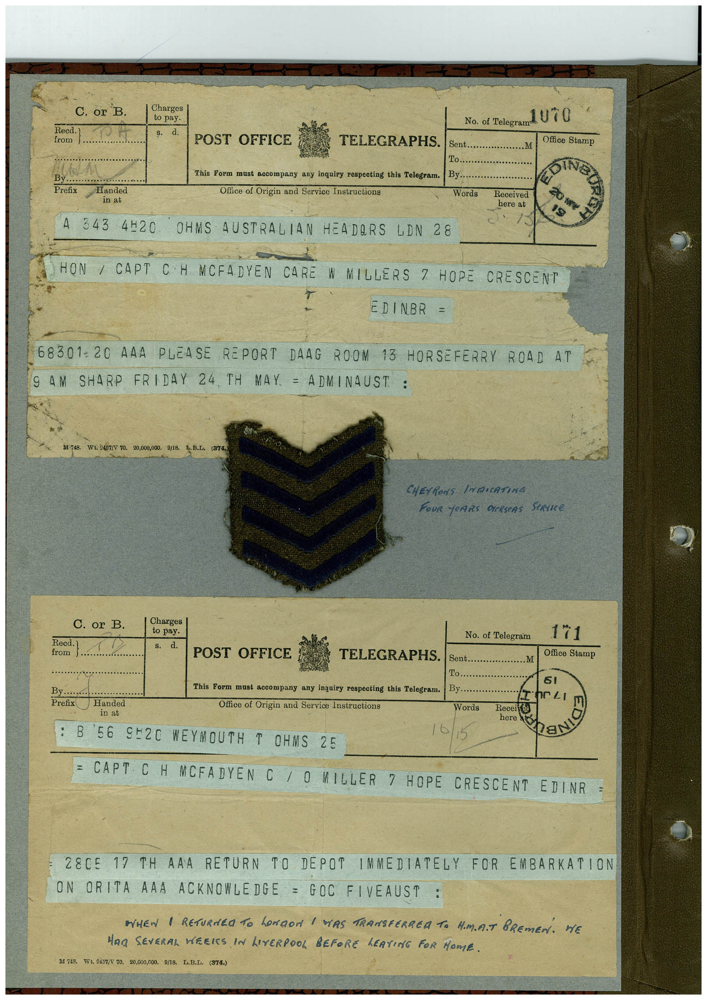

# Book 1 · scan 000

[Original scan](../../images/book-1/large/JPEG/BOOK1%20-%20001.jpg)

## Description

## Transcription

## Context

## Review notes

Compare the machine draft with the scan. Handwriting and names need human review.

## Artifacts

<!-- ARTIFACTS:START -->
Edit the artifacts field in this note’s frontmatter to change these records. This summary is generated.

### B01-S000-A01 — Telegram & Handwritten note — Book 1, scan 000

Types: Telegram, Handwritten note

Scope: Whole scanned page; individual items can be split out during review.

Caption: Not mapped yet.

Caption source: Not recorded yet.

Caption status: unmapped
<!-- ARTIFACTS:END -->

## Machine transcription

<!-- OCR:START -->
C. or B
Reed.
from
By
Prefix
Charges
to pay.
d.
Handed
in at
POST OFFICE
TELEGRAPHS.
This Form must accompany any inquiry respecting this Telegram.
Office of Origin and Service Instructions
343 4H20 OHMS AUSTRALIAN HEADORS LDN 28
Sent.
1o.
By.
Words
No. of Telegram U TO
.M
Office Stamp
OING
Received
here at
HON / CAPT CH MCFADYEN CARE W MILLERS 7 HOPE CRESCENT
EDINBR =
68301-20 AAA PLEASE REPORT DAAG ROOM 13 HORSEFERRY ROAD AT
AM SHARP FRIDAY 24
, TH MAY. = ADMINAUST :
D1 748. Wt. 0457/Y 70. 20,000,000. 9/18, To.B.L, (374,)
CHEVRONS INRICATING
FoUR YeARS DERSEAS StRICe
C. or B.
Reed.
from j.
I Charges
to pay.
s. d.
POST OFFICE
No. of Telegram
....
TELEGRAPHS.
Sent...
To..
By.
.M
171
Office Stamp
By...
Prefix Handed
in at
This Form must accompany any inquiry respecting this Telegram.
Office of Origin and Service Instructions
ne LI
Words
Received
here
B
56 9º20 WEYMOUTH T OHMS 25
8
= CAPT CH MCFADYEN C / O MILLER 7 HOPE CRESCENT EDINR
=
28C5 17 TH AAA RETURN TO DEPOT IMMEDIATELY FOR EMBARKATION
ON ORITA AAA ACKNOWLEDGE = GOC FIVEAUST :
AHEN | RETURNRO TO LONDON / WAS TRANSFERREA TO H.M.R.T BREMEN. HE
MAn SEVERAL WEEIS IN LIVERPOOL BEFORE LEAVING FOR HOME.
M 748.
Wt. 9457/V 70. 20,000,000. 9/18.
L.B.D. (374.)
<!-- OCR:END -->
