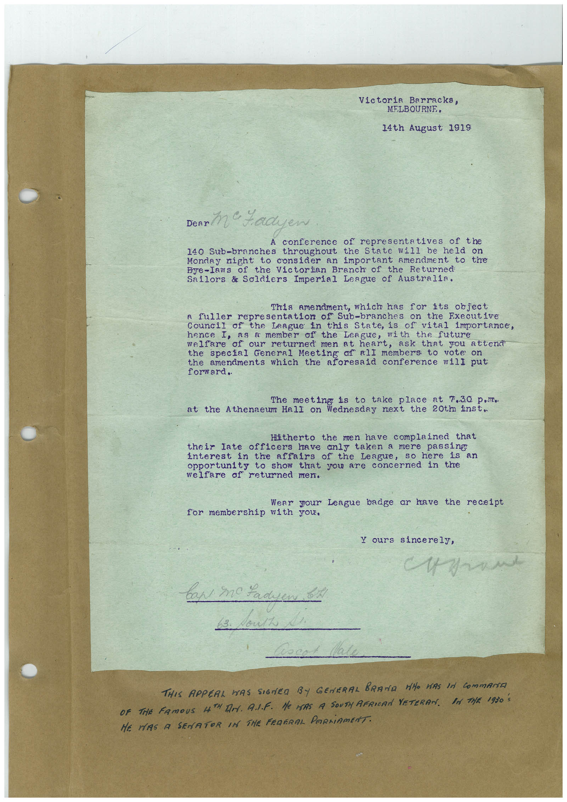

# Book 1 · scan 001

[Original scan](../../images/book-1/large/JPEG/BOOK1%20-%20002.jpg)

## Description

## Transcription

## Context

## Review notes

Compare the machine draft with the scan. Handwriting and names need human review.

## Artifacts

<!-- ARTIFACTS:START -->
Edit the artifacts field in this note’s frontmatter to change these records. This summary is generated.

### B01-S001-A01 — Letter — Book 1, scan 001

Types: Typed document, Letter

Scope: Whole scanned page; individual items can be split out during review.

Caption: Not mapped yet.

Caption source: Not recorded yet.

Caption status: unmapped
<!-- ARTIFACTS:END -->

## Machine transcription

<!-- OCR:START -->
Victoria Barracks,
MELBOURNE,
14th August 1919
Denn Me Yadyen
conference of representatives of the
140 Sub-branches throughout the State will be held on
Monday night to consider an important amendment to the
Bye-Iaws of the Victorian Branch of the Returned
Sailors & Soldiers Imperial League of Australia.
This amendment, which has for its object
a fuller representation of Sub-branches on the Executive
the League in this State, is of vital importance,
hence I, as a member of the League,
of our returned men at heart,
ask that you attend
the special General Meeting of all members to vote on
the amendments which the aforesaid conference will put
The meeting is to take place at 7.30 p,m.
at the Athenaeum Hall on Wednesday next the 20tm inst.
Hitherto the men have complained that
their late officers have anly taken a mere passing
interest in the affairs of the League,
so here is an
opportunity to show that you are concerned in the
welfare of returned men.
Wear your League badge or have the receipt
for membership with you,
ours sincerely,
THIS APPEAL WAS SIGNED
BY GENERAL BRAND WHO HAS IN COmmANTE
OF THE FAMOUS HTH DA. A.J.F. He MAS A SOUTH AFRICAN VETERAN. BA TAR 1930 S
HE HAS A
SENATOR IN THE FEDERAL PARLiAMENT.
<!-- OCR:END -->
