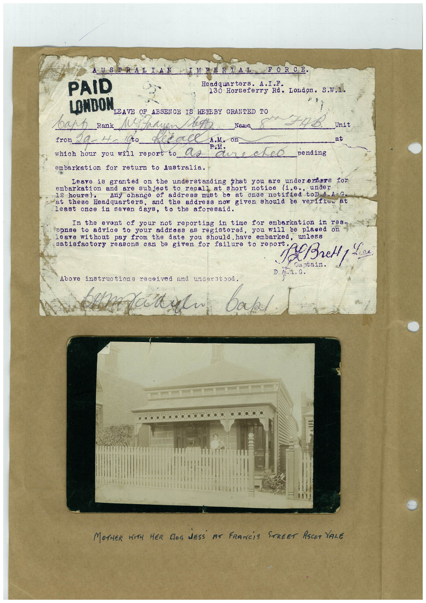

# Book 1 · scan 002

[Original scan](../../images/book-1/large/JPEG/BOOK1%20-%20003.jpg)

## Description

## Transcription

## Context

## Review notes

Compare the machine draft with the scan. Handwriting and names need human review.

## Artifacts

<!-- ARTIFACTS:START -->
Edit the artifacts field in this note’s frontmatter to change these records. This summary is generated.

### B01-S002-A01 — Typed document, Photo & Handwritten note — Book 1, scan 002

Types: Typed document, Photo, Handwritten note

Scope: Whole scanned page; individual items can be split out during review.

Caption: Not mapped yet.

Caption source: Not recorded yet.

Caption status: unmapped
<!-- ARTIFACTS:END -->

## Machine transcription

<!-- OCR:START -->
PAID
AUSTRALIAN IMPERIAL
FORCE.
Headquarters.
A.I.F.
130 Horseferry Rd. London. S.W.1.
LOMDON
LEAVE OF ABSENCE IS HEREBY GRANTED TO
варр
_Rank
M. tadi
Nama
Unit
from
at
which hour you will report to Ce
aure
eD pending
embarkation for return to Australia.
Leave is granted
understanding that you are undererders for
embarkation and are
short notice
(1.e..
under
hours).
address must be at once notified toD.a.AG.
at these
Eeadquarters,
and the address now given should be verifio at
least once in seven days, to the aforesaid.
In the event of your not reporting
in time for embarkation in res-
to advice to your address as registered, you will be plased
leave without pay from the date you should. have embarked, unlesa
satisfaotory reasons can be given for failure to report
A Bretty Lice.
Captain.
D. A 1. G.
Above instructions received and understood.
natal.
bake
...
MOTHER WITH HER DOS NESS AT FRANCiS STREET ASCOT VALE
<!-- OCR:END -->
