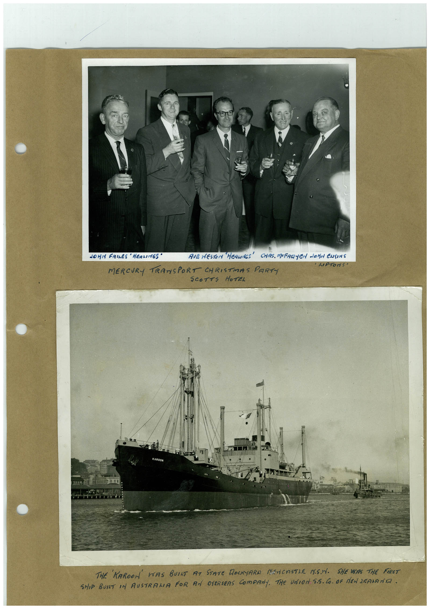

# Book 1 · scan 003

[Original scan](../../images/book-1/large/JPEG/BOOK1%20-%20004.jpg)

## Description

## Transcription

## Context

## Review notes

Compare the machine draft with the scan. Handwriting and names need human review.

## Artifacts

<!-- ARTIFACTS:START -->
Edit the artifacts field in this note’s frontmatter to change these records. This summary is generated.

### B01-S003-A01 — Photo & Handwritten note — Book 1, scan 003

Types: Photo, Handwritten note

Scope: Whole scanned page; individual items can be split out during review.

Caption: Not mapped yet.

Caption source: Not recorded yet.

Caption status: unmapped
<!-- ARTIFACTS:END -->

## Machine transcription

<!-- OCR:START -->
JOHN BRIES' HEALINGS •
MERCURY TRANSPORT CHRISTMAS PART-
SCOTTS HOTEL
THE KAROON HAS BUILT AT STATE DOCKYARD NEWCASTIK N.S.N. SHEVAS THE FiRST
SHIP BUILT IN AUSTRALIA FOR AN OVERSEAS COMPANY. THe VOION 5.5. Co. OF DEN 2RANANTA.
<!-- OCR:END -->
