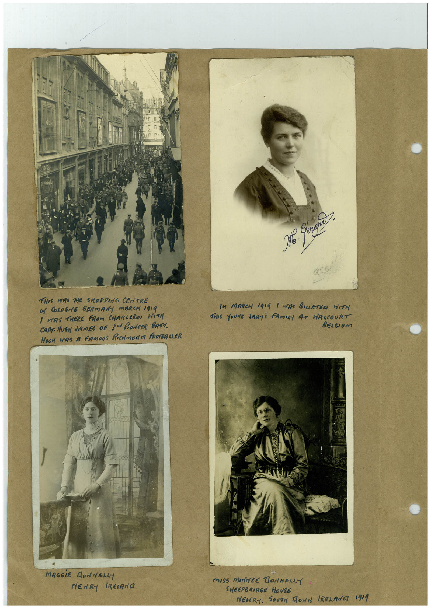

# Book 1 · scan 004

[Original scan](../../images/book-1/large/JPEG/BOOK1%20-%20005.jpg)

## Description

## Transcription

## Context

## Review notes

Compare the machine draft with the scan. Handwriting and names need human review.

## Artifacts

<!-- ARTIFACTS:START -->
Edit the artifacts field in this note’s frontmatter to change these records. This summary is generated.

### B01-S004-A01 — Photo & Handwritten note — Book 1, scan 004

Types: Photo, Handwritten note

Scope: Whole scanned page; individual items can be split out during review.

Caption: Not mapped yet.

Caption source: Not recorded yet.

Caption status: unmapped
<!-- ARTIFACTS:END -->

## Machine transcription

<!-- OCR:START -->
THIS WAS THE SHOPPING CENTRE
IN COLOGNE GERMANY MARCH 1919
I WAS THERE FROM CHARLEROI WITY
CAPT. HUGN LAmES OF SuPONCeR BATT.
HUGH WAS A FAMOUS RICHMONA FOOTBALLER
MAGGIE DONNELLY
NEWRY IRELANA
Сечане
Но 1
IN MARCH 1909 1 WAS BULLETED WITH
THIS YoUNG LADyS FAmILY AT WALCOURT
BELGIUm
mISS mINEE DONNELLY
SHEEPBRINGE HOUSE
NEWRY.
SOVEN MONA IRELANA 1919
<!-- OCR:END -->
