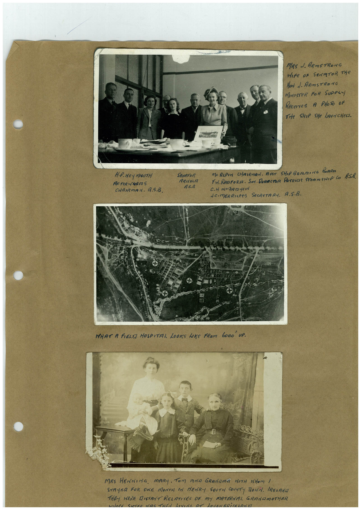

# Book 1 · scan 005

[Original scan](../../images/book-1/large/JPEG/BOOK1%20-%20006.jpg)

## Description

## Transcription

## Context

## Review notes

Compare the machine draft with the scan. Handwriting and names need human review.

## Artifacts

<!-- ARTIFACTS:START -->
Edit the artifacts field in this note’s frontmatter to change these records. This summary is generated.

### B01-S005-A01 — Photo & Handwritten note — Book 1, scan 005

Types: Photo, Handwritten note

Scope: Whole scanned page; individual items can be split out during review.

Caption: Not mapped yet.

Caption source: Not recorded yet.

Caption status: unmapped
<!-- ARTIFACTS:END -->

## Machine transcription

<!-- OCR:START -->
MRS J. ARmSTRONG
Nore oF SErATOR THe
HaN N. ARmSTRONG
MArISTeR FoR SUpPL
Recerres A PHOTO oF
Tite ShiP SHe LAUNCHeD
HiP. Hey moUTH
AFTeR-BRAS
CHAIRMAN. A.S.B.
SENATOR
ARNOLA
AS.A
Me ALPIN CHRIRMAN. RUST SHOP BUILDING BOARE
Fr. RADFORE. SOr. DORECTOR PATRICIA STEOMSNIP CO ASh.
NE-MERRILPES SeCRETARY. A.S.B.
WHAT A FIELT HOSPITAL LOOKS WRE FROM bODO UP.
MRS HENMING. MARI. TOM ANA GRANAME MITH NOM I
STAYER FOR ONE MONTH IN MErRY SOUTH COUNTY TOWN. IRENANA
THEY WERE MISTANT RELATIVES OF MY MATERNAL GRANUMOTHER
NAnCE SICSSO NDS THEN LININE AN LONENARiCKLONE
<!-- OCR:END -->
