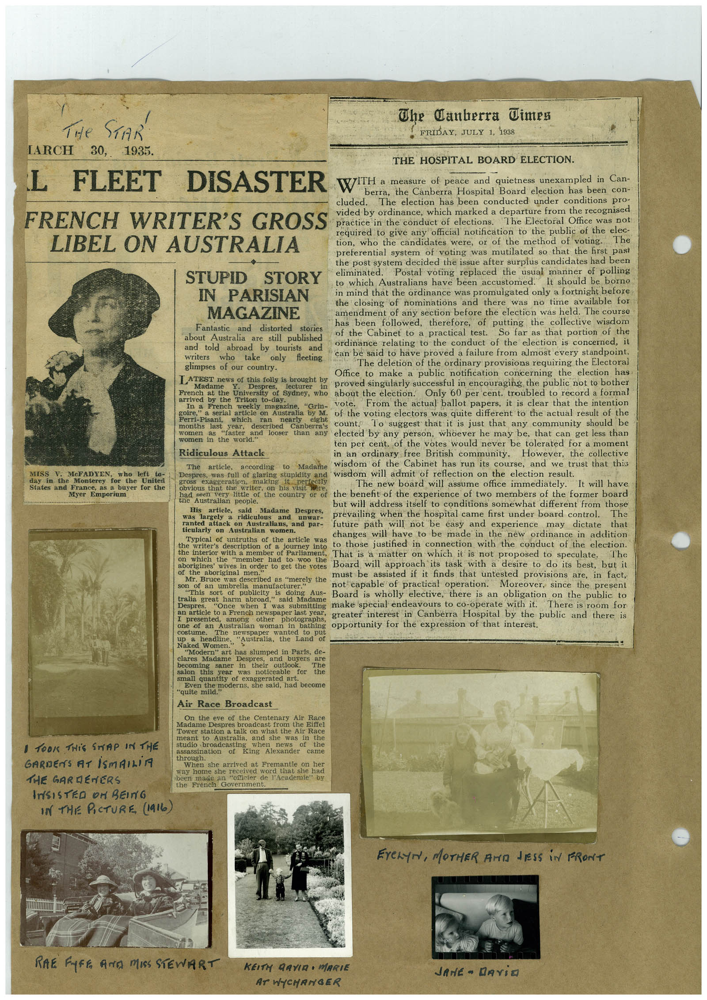

# Book 1 · scan 006

[Original scan](../../images/book-1/large/JPEG/BOOK1%20-%20007.jpg)

## Description

## Transcription

## Context

## Review notes

Compare the machine draft with the scan. Handwriting and names need human review.

## Artifacts

<!-- ARTIFACTS:START -->
Edit the artifacts field in this note’s frontmatter to change these records. This summary is generated.

### B01-S006-A01 — Newspaper clipping, Photo & Handwritten note — Book 1, scan 006

Types: Newspaper clipping, Photo, Handwritten note

Scope: Whole scanned page; individual items can be split out during review.

Caption: Not mapped yet.

Caption source: Not recorded yet.

Caption status: unmapped
<!-- ARTIFACTS:END -->

## Machine transcription

<!-- OCR:START -->
Y
Tite STAR
TARCH
30,
1935.
The Canberra Jimes
FRIDAY, JULY 1, 1938
THE HOSPITAL BOARD ELECTION.
L FLEET DISASTER
WITH a measure of peace and quietness unexampled in Can-
berra, the Canberra Hospital Board election has been con-
cluded.
The election has been conducted under conditions pro-
FRENCH WRITER'S GROSS
LIBEL ON AUSTRALIA
vided by ordinance, which marked a departure from the recognised
practice in the conduct of elections.
The Electoral Office was not
required to give any official notification to the public of the elec-
tion, who the candidates were, or of the method of voting.
The
preferential system of voting was mutilated so that the first past
the post system decided the issue after surplus candidates had been
STUPID STORY
eliminated.
Postal voting replaced the usual manner of polling
to which Australians have been accustomed.
It should be borno
IN PARISIAN
in mind that the ordinance was promulgated only a fortnight before
the closing of nominations and there
was no time available for
MAGAZINE
amendment of any section before the election was held. The course
Fantastic
has been tollowed, therefore,
the collective wisdom
and distorted stories
about Australia are still published
of the Cabinet to a practical test.
st utifar as cat portion of one
and told abroad by tourists
and
ordinance relating to the conduct of the election is concerned, it
writers
who
take
only
fleeting
can be said to have proved a failure from almost every standpoint.
glimpses of our country.
The deletion of the ordinary provisions requiring the Electoral
Office to make a public notification concerning the election has
LATEST news of this folly is brought by
Madame
Despres,
lecturer
in
proved singularly successful in encouraging the public not to bother
French at the University of Sydney,
about the election.
Only 60 per cent. troubled to record a formal
In a
goire,
French
weekly
magazine,
"Grin-
vote.
From the actual ballot papers, it is clear that the intention
a serial article on Australia by
of the voting electors was quite different to the actual result of the
Hermi- Pisani
3589
months last
year,
described
Canberra's
count
To suggest that it is just that any community should be
women
"faster
and looser than any
elected by any person, whoever he may be, that can get less than
women m the
ten per cent. of the votes would never be tolerated for a moment
Ridiculous
Attack
in an ordinary free British community.
However, the collective
The
article,
according
to
Madame
wisdom of the Cabinet has run its course, and we trust that this
MISS V.
McFADYEN,
who left
to-
Monterey
States and France,
as a buyer for the
Myer Emporium
wisdom will admit of reflection on the election result.
gross
exaggeration,
making
obvious that
on
it
perfectly
his visit
The new board will assume office immediately. It will have
sele
very little
or toe county or of
the benefit of the experience of two members of the former board
the
Australian people.
but will address itself to conditions somewhat different from those
His
article,
said
Madame
Despres,
was
largely
ridiculous
and
ranted
LEAR WAL"
prevailing when the hospital came first under board control.
The
attack on Australians.
future path will not be easy and experience may dictate that
ticularly on Australian women.
changes will have to be made in the new ordinance in addition
Typical of untruths of the article was
the
writer's description
of a
journey into
to those justified in connection with the conduct of the election.
the interior
That is a matter on which it is not proposed to speculate.
The
"member
had to
woo
the
aborigines'
wives in
of
order to get the votes
Board will approach its task with a desire to do its best, but it
the
aboriginal
TACH
Mi. Bruce was described as merely the
must be assisted if it finds that untested provisions are, in fact,
son of an umbrella manufacturer."
not capable of practical operation. Moreover, since the present
"This
sort
tralia
of
publicity
doing
Aus-
a broad.
Board is wholly elective, there is an obligation on the public to
-hea
when 1
was
submitting make special endeavours to co-operate with it.
There is room for
an article to a French newspaper last year,
VA COCALUCLE
other
photographs,
greater interest in Canberra Hospital by the public and there is
opportunity for the expression of that interest.
costume.
The newspaper
wanted to put
up
Land
of
Naked Women.
"Modern art has sumped in Paris. de-
clares Madame
Despres,
and buyers
becoming
saner
are
in
DATOLE
The
this
was noticeable
for
the
small quantin or exaggerated ant.
Even the
moderns, she said, had become
"quite mild.
Air Race Broadcast
On the eve of the Centenary Air Race
Madame Desores broadcast tom the site!
Tower station a talk on what the Air Race
meant
to
Australia, and she
was in the
1 TOOK THIS SNAP IN THE
GARDENS AT iSMAILiA
THE GARDENERS
INSISTED on BeinG
IN THE PICTURE (1916)
WELCH
assassination
King
HICWS
the
through
came
When she arrived at Fremantle on her
way home she received word that she had
been made an "officier de l'Academie" by
the French
EYeLYN, MOTHER AND JESS iN FRONT
RAE FUFE AND MISS STEWART
KEITH GAYIR • MARIE
AT WYCHANGER
JANE - RAViO
<!-- OCR:END -->
