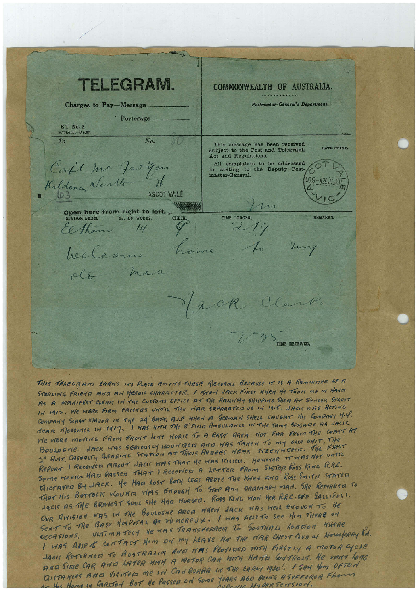

# Book 1 · scan 008

[Original scan](../../images/book-1/large/JPEG/BOOK1%20-%20009.jpg)

## Description

## Transcription

## Context

## Review notes

Compare the machine draft with the scan. Handwriting and names need human review.

## Artifacts

<!-- ARTIFACTS:START -->
Edit the artifacts field in this note’s frontmatter to change these records. This summary is generated.

### B01-S008-A01 — Telegram, Newspaper clipping & Handwritten note — Book 1, scan 008

Types: Telegram, Newspaper clipping, Handwritten note

Scope: Whole scanned page; individual items can be split out during review.

Caption: Not mapped yet.

Caption source: Not recorded yet.

Caption status: unmapped
<!-- ARTIFACTS:END -->

## Machine transcription

<!-- OCR:START -->
TELEGRAM.
Charges to Pay-Message
Porterage.
E.T. No. 2
D.79/4.8.0.90316
To
No.
Caft me Fairyon
Kildonan
Vanta
•
03
ASCOT VALE
20000
Open here from right to left..
SIATION EKOM.
No. OF WORDS.
CHECK.
Eethan
14
hecleane
olE
home
ma a
COMMONWEALTH OF AUSTRALIA.
Postmaster-General's Department,
This message has
been received
subject to the Post and Telegraph
Act and Regulations.
All complaints to
be addressed
in writing to the Deputy Post-
master-General.
DATH STAME
OT
(29-425JL195
TIME LODGED.
219
REMARKS.
2my
Mack Clark.
TIME RECEIVED,
THIS TELEGRAM EARNS ITS PANCE AMONG THESE RECORAS BECAUSE IT IS A REmINDER
OF A
STERLING FRIEND AN AN HEROIC CHARACTER. I TREN LACK FIRST NHEN He TODIS ME IN MANE
AS A MANIFEST ChERIS IN THE CUSTOMS OFFICE AT THe RAMAY SHIPPING SHER AT SPENCER STReET
IN o9I2. We WERe FIRM FRIeNS UNTIL THe VAR SEPARATOR US IN IGIS. JACI WAS ACTING
NeAR MessInes oN 1917-
I WAS WITH THe & FIERA AmBULANCE IN THe SAme BRIGARE AS LACIE
ne weRe movinG FRoM FRONT hOMe HORIE TO A REST ARCA NOT FAR FROM THe COAST AT
BOULoGNe. JACK WAS SERIOUSLY HOUNDeD AND WAS TAKEN TO mY OLA UNIT, THe
2ª AUST. CASUALT GEARING STATION AT TROIS ARBRES NEAR STEENHERCE. THe
FIRST
RePORT 1 RECENCE ABOUT NACK HAS THAT He HAS KILLER. HOWEVER IT WAS NOT UNTIL
Seme meera HAM PASSeD THAT 1 ReCeNCO A LeTTER FROM SISTER ROSS KING RR.C.
MICTATeR BYJACK. He HAD LOST BOTy LEGS ABOve THe Kee AND ROSS SmITH STATED
THAT HIS BUTTOCK WOUNA VAS ENDUGM TO STOP ANY ORDINARI MAN. SHe REPERRErA TO
NACK AS THE BRAVeST SOUL SHe MAn MURSeR. ROSS KING WON HeR RR.C. ORE SALLIPOLI.
OUR ANISION WAS IN THe BOULOGNe AREA WHEN JACK WAS HEAL ENOUGN To BE
Sent to THe BAse HOSPITaL As WImeRCUX. I WAS ABLeTO See HIm THeRe ON
URTIMATELY HE WAS TRANSFeRRER TO SOUTHALL hOMMON THeRE
I WAS ABLe R CONTACT Nom oN my LeAve AR THe MAR CHeST ChUB al MorefeRRy Rod.
JACI ReTURNeD TO AUSTRALIA ARE MAAS PROVIDeD WITH FIRSTLY A MOTOR CYCLe
AND SINE CAR AND LATER WITH A MOTOR CAR BIT HAnTA CONTROLS. He merT LoNG
DISTANCES AND VISITeR Me IN CANBeRRA IN THe CARLY 1930, 1 SAN HAm OFTEN
she Hame in CARAToN BUT He PASSeR oN SOme YORS AGO BeDra A SURReROR FROm
<!-- OCR:END -->
