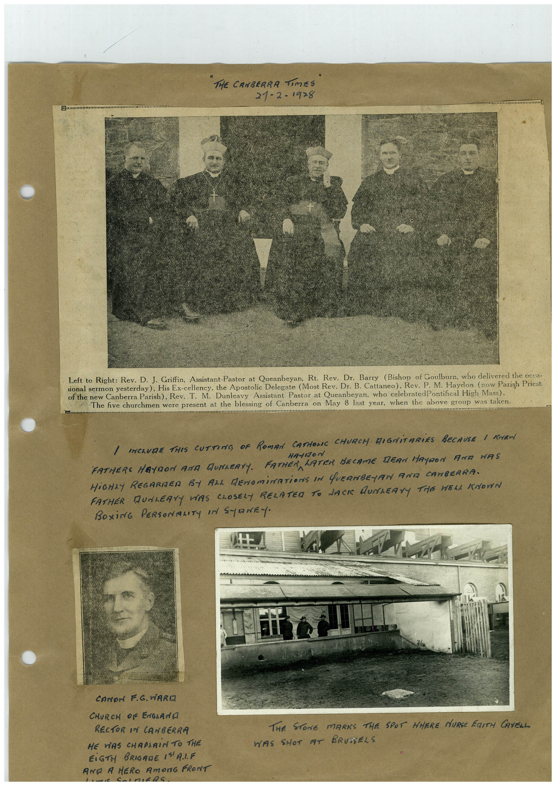

# Book 1 · scan 010

[Original scan](../../images/book-1/large/JPEG/BOOK1%20-%20011.jpg)

## Description

A newspaper group portrait, a handwritten recollection of Canberra clergy, a portrait captioned Canon F. G. Ward, and a photograph associated with Edith Cavell in Brussels.

## Transcription

## Context

This page connects the compiler’s memories of local clergy with a wartime memorial scene. Names and relationships here are attributed to the printed and handwritten captions. Artifact descriptions are an initial visual reading, and the full page transcription remains a machine draft.

## Review notes

Compare the machine draft with the scan. Handwriting and names need human review.

## Artifacts

<!-- ARTIFACTS:START -->
Edit the artifacts field in this note’s frontmatter to change these records. This summary is generated.

### B01-S010-A01 — Canberra clergy — newspaper cutting

Types: Newspaper clipping

Scope: Individual item or region.

Caption: Not mapped yet.

Caption source: Not recorded yet.

Caption status: unmapped

Transcription: The printed caption names Rev. D. J. Griffin, Rt. Rev. Dr. Barry, Most Rev. Dr. B. Cattaneo, Rev. P. M. Haydon and Rev. T. M. Dunleavy, from left to right.

Context: The handwritten heading attributes the cutting to The Canberra Times, 21 February 1928. The printed caption says the group was photographed at the blessing of Canberra on May 8 the previous year. These details are read from the page and await independent source checking.

People: [[p-m-haydon]] · [[t-m-dunleavy]]

### B01-S010-A02 — Canon F. G. Ward

Types: Portrait photo

Scope: Individual item or region.

Caption: Not mapped yet.

Caption source: Not recorded yet.

Caption status: unmapped

Transcription: Canon F. G. Ward / Church of England / Rector in Canberra

Context: Identification comes from the handwritten caption, not facial recognition. The face detector’s possible-person region remains for human verification.

People: [[f-g-ward]]

### B01-S010-A03 — A memorial site in Brussels

Types: Photo

Scope: Individual item or region.

Caption: Not mapped yet.

Caption source: Not recorded yet.

Caption status: unmapped

Transcription: The stone marks the spot where Nurse Edith Cavell was shot at Brussels.

Context: The compiler associates this scene with Edith Cavell. The people visible in the photograph are unidentified. Cavell is mentioned by the caption; she is not asserted to be pictured.

People: [[edith-cavell]]
<!-- ARTIFACTS:END -->

## Machine transcription

<!-- OCR:START -->
THE CANBERRA
Times
21-2-19>8
Drumm
Left to Right: Rev. D. J. Griffin, Assistant-Pastor at Queanbeyan, Rt. Rev. Dr. Barry (Bishop of Goulburn, who delivered the occa-
sional sermon yesterday). His Ex-cellency, the Apostolic Delegate (Most Rev. Dr. B. Cattaneo), Rev. P.M. Haydon (now Parish Priest
of the new Canberra Parish), Rev. T. M. Dunleavy Assistant Pastor at Queanbeyan, who celebratedPontifical High Mass).
The five churchmen were present at the blessing of Canberra on May 8 last year, when the above group was taken.
/ INCLUDE THIS CUTTING OF ROMAN CATHONE CHURCH DIGNiTARiES BECAUSE I KEN
FATHERS MAYDON AND MUNLERTY. FATHERA
HA-1120 n
LATER BECAME DEAN HAYDON ANA HAS
HiGHLY REGARDER BY ALL DENOMINATiONS IN QUEANBEJAN ANIZ CANBERRA.
FATHER DUNLEAYY WAS CLOSELY RELATED TO JACK DUNLEAYY THE HELL KNOWN
BOXiNG PERSONALITY IN SYRNEY.
CANON F.G. VARIA
CHURCH OF ENGLANA
RECTOR IN CANBERRA
HE WAS CHAPLAIN TO THE
EiGTH BRIGADE I"A.IF
ANA A HERO AmOnG FRONT
THE STONE MARKS THE SPOT WHERE NURSE FaITH CAVELL
WAS SHOT AT BRUSSELS
<!-- OCR:END -->
