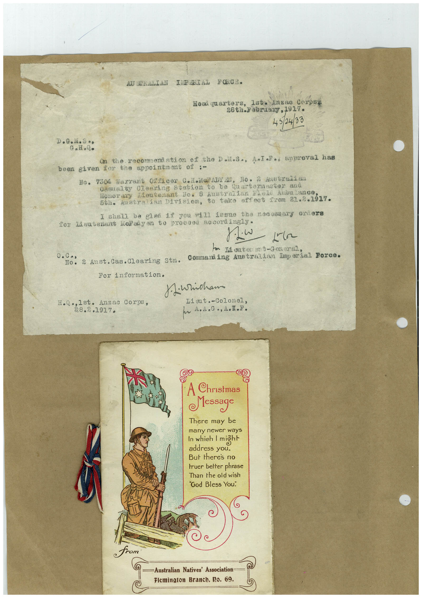

# Book 1 · scan 011

[Original scan](../../images/book-1/large/JPEG/BOOK1%20-%20012.jpg)

## Description

## Transcription

## Context

## Review notes

Compare the machine draft with the scan. Handwriting and names need human review.

## Artifacts

<!-- ARTIFACTS:START -->
Edit the artifacts field in this note’s frontmatter to change these records. This summary is generated.

### B01-S011-A01 — Invitation, Greeting card & Handwritten note — Book 1, scan 011

Types: Invitation, Greeting card, Handwritten note

Scope: Whole scanned page; individual items can be split out during review.

Caption: Not mapped yet.

Caption source: Not recorded yet.

Caption status: unmapped
<!-- ARTIFACTS:END -->

## Machine transcription

<!-- OCR:START -->
AU SERALIAN IMPARIAL FORCE.
Heai quarters,
Isto Anzao Corpse
28th-20lraa77,1917.
45/24/33
D.G..S•s
G.H.Q.
on the recomendation of the Doil.s., A•I.I., approval has
been given for the appointmont of ;-
No. 7304 Warrant 0281cer 0.ii/ADY AN, No. 2 Austrelian
casualty Cleering Station
be Quarternster and
Honorary Lieutenant No. 8 Australian Flelo Anbalance
56. Australian Division, to take effect teon 21.2.1317.
I shall
be glad
you will iesne the necessary orders
for Meutenant Wellaiyen te proceed aocordingly•
- 2r
m 1 outer ant-Jon eral
0. Co,
Conmand ing Australian Imperial Porce.
2 Aust. Cas. Clearing Stn.
For information.
jiwricham
Lieut. -Colonel,
H.Q .,Ist. Anzac Corps,
38.2.1917.
A Christmas
Message
There may be
many newer ways
In which 1 miğht
address you.
But theres no
truer better phrase
Than the old wish
"Cod Bless You.
C
from
—Australian Natives' Association
Flemington Branch. I2o. 69.
<!-- OCR:END -->
