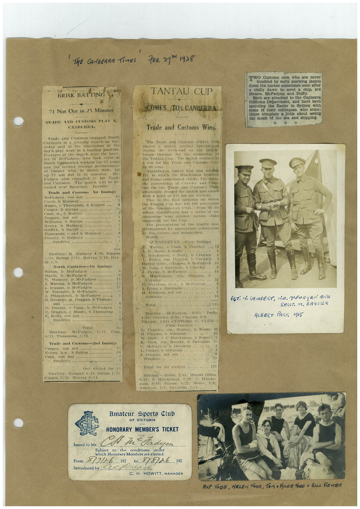

# Book 1 · scan 012

[Original scan](../../images/book-1/large/JPEG/BOOK1%20-%20013.jpg)

## Description

## Transcription

## Context

## Review notes

Compare the machine draft with the scan. Handwriting and names need human review.

## Artifacts

<!-- ARTIFACTS:START -->
Edit the artifacts field in this note’s frontmatter to change these records. This summary is generated.

### B01-S012-A01 — Newspaper clipping, Photo & Handwritten note — Book 1, scan 012

Types: Newspaper clipping, Photo, Handwritten note

Scope: Whole scanned page; individual items can be split out during review.

Caption: Not mapped yet.

Caption source: Not recorded yet.

Caption status: unmapped
<!-- ARTIFACTS:END -->

## Machine transcription

<!-- OCR:START -->
' THE CANBERRA TIMES
7EB. 217H1928
BRISK BATTING
71 Not Out in 25 Minutes
TRADE AND CUSTOMS PLAS
CANBERRA.
Trade and Customs engaged North
Canberra in a friendly mateh on Sat-
urday and at the conclusion of the
day's play were in a leading position.
Features of the match were the bout-
ine of Meladgen, who took eight or
North Canberra's wickets for 17 runs.
and the second innings performance
of Cooper
in merry styte.
hit
up 71 not out in 35 minutes.
Mc.
Padgen also compiled 5l for Tradi
and Customs.
The match will be re-
sumed next Saturday.
Results:
Trade and Customs
Ist Innings
Meladgen, run out .....
Comb Me............
Moore, e Thompson, b Rippon
Cooper, b Sutton:
Cook, st., b Murray.
Durgan. not onl
Williams, b Sutton
Kenny, b Maloney
Thompson, c and b Maloney
Denav b Maloney..........
.....sunoes....
104
Rowling: R.
Maloney 4/36, Rippon
1/28, Sutton 2/12, Murray 1/16, Har-
North Canberra-Ist Innings
Sutton,
b
Meladgen
Havill, b MeFadgen
Maloney, b McFadgen
J. Murray, b MeFadgen
J. Kippon.
DVICE daba
W.
tomosit. o Meradeen..
Fitzpatrick.
b Meladgen
B. Geeorge, st. Duggan, b Thomp-
son
B.
Dunloy.
Cook, b MeFadgen
Bradley. e Moore, b Thompson
V. Kelly, not out
Sundries .......
Total
Bowling:
Mcladgen
0/21, Thompson 2/23.
65
S/17, Cool
Trade and Customs-2nd Innings
Cooper,
not out
Kenny, h.w.. b Sutton
Cook,
not out.
Sundries o
One wicket for
Bowling: Maloney 0/28, Sutton 1/25
Rippon 0/20. Murray 0/14.
TANTAU CUP
COMES /TOL CANBERRA.
Trade and Customs Wins.
The Trade and Customs cricket Clut
played
match against
Queanheyan
during
the
week-end
on the
heyan
Ground. for
the ownersit of
the antu in.
The match resuited in
a win for the Trade and Customs Cinh
By 60 runs.
Queanbeyan batted first and totalled
11b, to which the Hincksman brothers
and Zeims contributed chiefly. The open-
ing partnership of Crawley and Clap-
COTTON
Trade and Custom's Club.
practically decided the match and closed
with a total of 175 for six wickets.
This
is the first occasion on which
the Tantau Cup has left the possession
of the Queanbeyan Club.
defeat, Queanbeyan had a series of six
successive
wins against various clubs
competing for the Cup:
The presentation of the trophy was
accompanied by appropriate celebration
By the victors and vanquished.
Scores:
QUEANBEYAN. First Innings.
B.
Marray. e Cook, b Crawley
A. F. Moore, b Dully
C. Hineksman, e Dully. D Crawley
L. Zelnis, stp. Duggan, b Crawles
Harold Gibbs, e Cooper. b MeFadyen
W. Saba, e Entwistle, b Crawley
J. Pavior. b McFadven
Hineksman,
ost p.
Crawley
E. Davidson, Lb.w., b MeFadyen
3. Gibbs, © Intwistle
H. Atkinson, not out
Sundries
Total
.. 115
Bowling: McFadyen.
Duffy.
1/10: Crawley, 6/36; Clapson, 0/9.
TRADE AND CUSTOMS C
CLUB.
First Innings.
Murray.
b Zeims
H. Clapson. D Atkinson..
W. Dully. e CHineksman. b Zeims
K.
Cook
Stp. Murmy, b Davidson
Mebadyen, b Davidson
L. Cooper. b Atlinson..
J. Duggan. not out
Sundries
12
Total, for six wiekets•
175
Bowling: Weims, 2/41: Harold Gibbs,
0/24: S. Hineksman, 0/29; C. Hincks-
man. 0716;
Pavior. 0/23; Moore, 0/9:
Atkinson, 2/8: Davidson, 2/11.
TWO Customs men who are never
troubled by early morning jaunts
down the harbor sometimes soon after
a chilly
dawn to meet a ship, are
Messrs.
McFadyen and Duffy.
Both are attached to the Canberra
Customs Department, and have been
spending the Easter in Sydney with
some of their colleagues, who some-
times complain a little about seeing
too much of the sea and shipping.
SOT. 1 LAMBERT. NO. MeERAYEN Ara
SEAST. M. BASTER
ALBERT PARK 1915
Elmateur
sports Club
OF VICTORIA
HONORARY MEMBER'S TICKET
Issued to Mr.
Ta
d
Subject
the
conditions
under
which Honorary Members are elected.
From
212/26
192
10 8/8/26 192
Introduced by.
C. H. HOWITT, MANAGER
ALF TODa, HELEN TORE, TOM + HeaR TORO a BILe LEWAR
<!-- OCR:END -->
