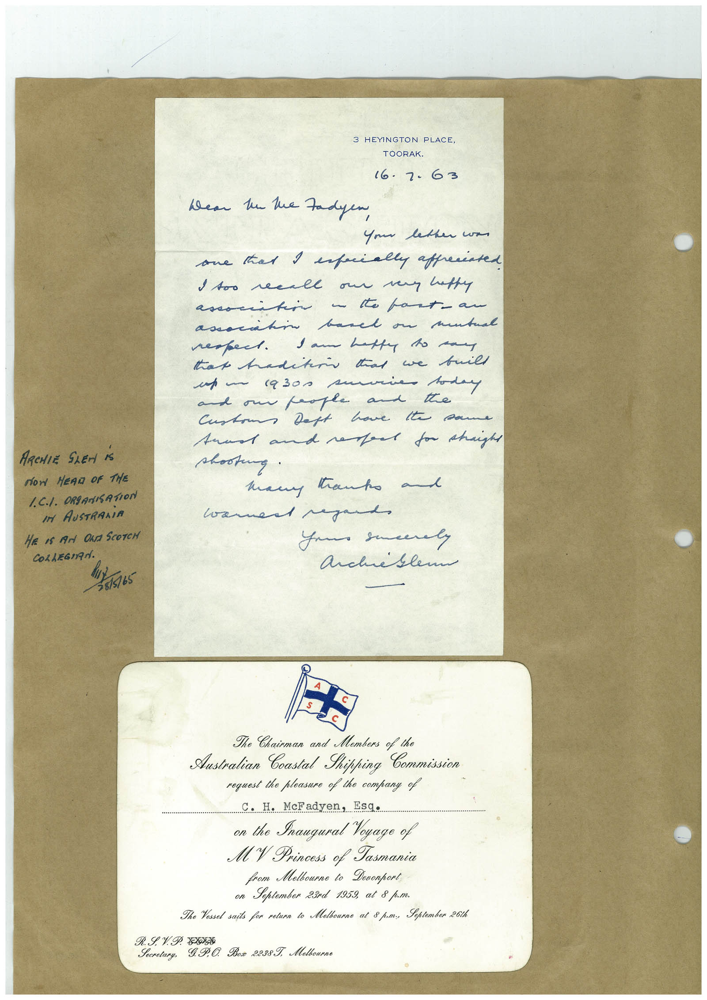

# Book 1 · scan 013

[Original scan](../../images/book-1/large/JPEG/BOOK1%20-%20014.jpg)

## Description

## Transcription

## Context

## Review notes

Compare the machine draft with the scan. Handwriting and names need human review.

## Artifacts

<!-- ARTIFACTS:START -->
Edit the artifacts field in this note’s frontmatter to change these records. This summary is generated.

### B01-S013-A01 — Invitation & Handwritten note — Book 1, scan 013

Types: Invitation, Handwritten note

Scope: Whole scanned page; individual items can be split out during review.

Caption: Not mapped yet.

Caption source: Not recorded yet.

Caption status: unmapped
<!-- ARTIFACTS:END -->

## Machine transcription

<!-- OCR:START -->
3 HEYINGTON PLACE,
TOORAK.
16.7.63
Wear he lue Fadyen
Your letter won
one tat I especially apprenated
I too recall our very luffy
associtin a to part- an
assocatin basel on mutual
sam hat to man
ARCHIE SLEN IS
How HEAR OF THE
1.C./. ORGANISATION
IM AUSTRARiA
HE IS FArI ONTA SCOTCH
COLLEGIAN.
28/5/65
shooting.
many tanks al
warned regard,
Your sucerly
Archiblem
Secretary,
The Chairman and Members of the
Australian Coastal Shipping
Commission
request the pleasure of the company of
C. H. McFadyen, Esq.
on the Inaugural Yoyage of
MY Princess of Tasmania
from Melbourne to Devonport
on September 23rd 1959, at 8 p.m.
The Yessel sails for return to Melbourne at 8 p.m., Soptember 26th
9 P. O. Box 2238 J. Molbourne
<!-- OCR:END -->
