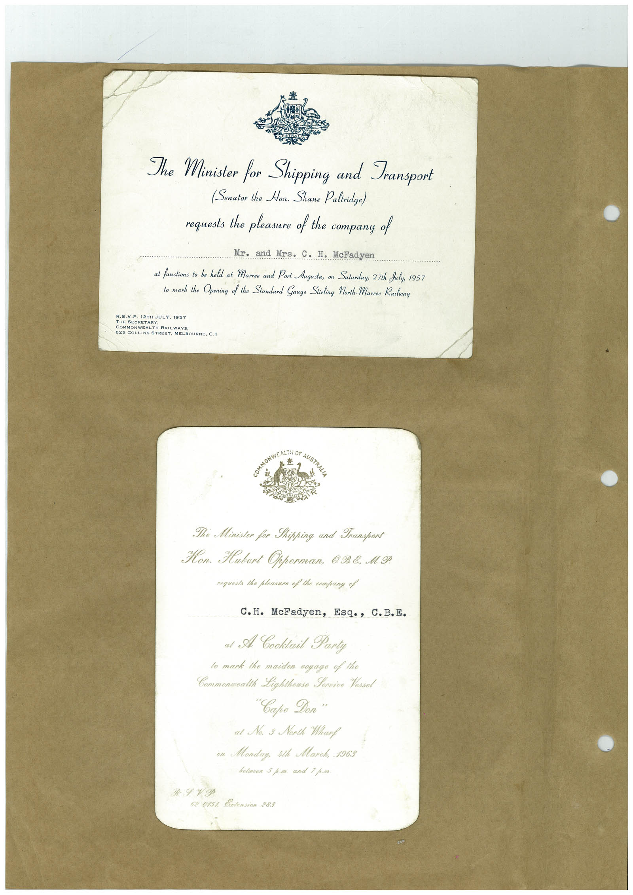

# Book 1 · scan 015

[Original scan](../../images/book-1/large/JPEG/BOOK1%20-%20016.jpg)

## Description

## Transcription

## Context

## Review notes

Compare the machine draft with the scan. Handwriting and names need human review.

## Artifacts

<!-- ARTIFACTS:START -->
Edit the artifacts field in this note’s frontmatter to change these records. This summary is generated.

### B01-S015-A01 — Invitation — Book 1, scan 015

Types: Invitation

Scope: Whole scanned page; individual items can be split out during review.

Caption: Not mapped yet.

Caption source: Not recorded yet.

Caption status: unmapped
<!-- ARTIFACTS:END -->

## Machine transcription

<!-- OCR:START -->
The Minister for Shipping and Transport
(Senator the Hoir. Shane Paltridge)
requests the pleasure of the company of
Mr. and Mrs. C. H. McFadyen
at functions to be held at Marree and Port Augusta, on Saturday, 27th July, 1957
to mark the Opening of the Standard Gauge Stirling North-Marree Railway
R.S.V.P. 12TH JULY. 1957
THE SECRETARY
COMMONWEALTH RAILWAYS
623 COLLINS STREET. MELBOURNE, C.I
The Ministon for Shipping and Transport
Hon. Hubert Opperman, 098. M.Ф.
roguests the plotsure of the company of
C. H. McFadyen, Esq., C.B.E.
al A Cooktail Parly
lo mark the maiden voyage of the
Commonwalth Lighthouse Fornice Yessol
"Саро Доп"
at No. 3 North Wharf
on Monday, ith March, 1963
52 015% Entension 283
<!-- OCR:END -->
