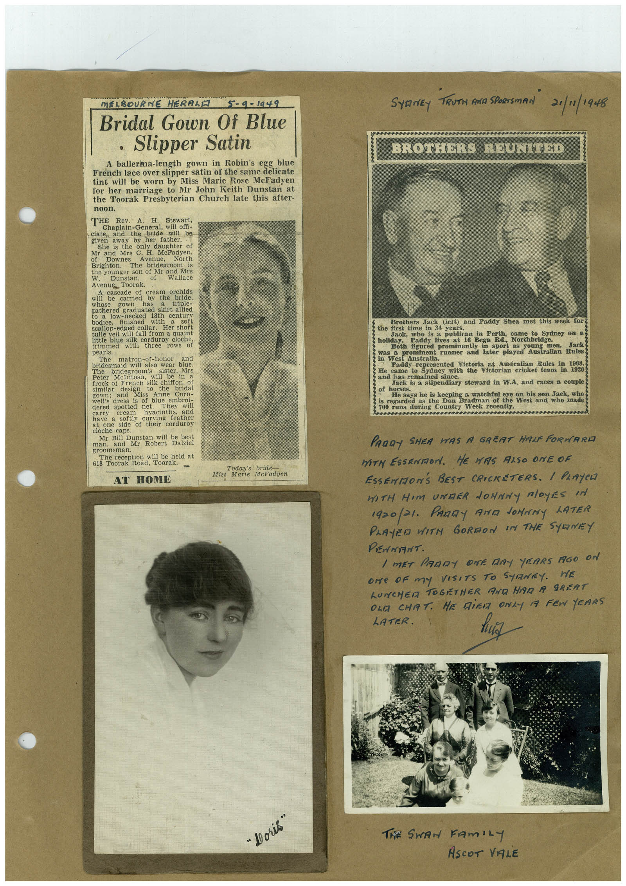

# Book 1 · scan 016

[Original scan](../../images/book-1/large/JPEG/BOOK1%20-%20017.jpg)

## Description

## Transcription

## Context

## Review notes

Compare the machine draft with the scan. Handwriting and names need human review.

## Artifacts

<!-- ARTIFACTS:START -->
Edit the artifacts field in this note’s frontmatter to change these records. This summary is generated.

### B01-S016-A01 — Newspaper clipping, Photo & Handwritten note — Book 1, scan 016

Types: Newspaper clipping, Photo, Handwritten note

Scope: Whole scanned page; individual items can be split out during review.

Caption: Not mapped yet.

Caption source: Not recorded yet.

Caption status: unmapped
<!-- ARTIFACTS:END -->

## Machine transcription

<!-- OCR:START -->
MELBOURNE HERALE
5-9-1949
Bridal Gown Of Blue
• Slipper Satin
A ballerina-length gown in Robin's egg blue
French lace over slipper satin of the same delicate
tint will be worn by Miss Marie Rose McFadyen
for her marriage to Mr John Keith Dunstan at
the Toorak Presbyterian Church late this after-
noon.
THE
Rev.
A.
H.
Stewart,
Chaplain-General, will off-
ciate, and the
bride
will be
given away by her
father.
She is
the only daughter of
Mr and Mrs C.
of
Downes
H. McFadyen
Avenue,
North
Brighton.
The
bridegroom
is
the younger son of Mr and Mrs
W.
Dunstan,
of
Wallace
Avenuc, Toorak.
A cascade of
cream orchids
will
carried
by
the
bride,
triple
whered graduated skirt allied
bodice.
low-necked 18th centurs
finished
with
soft
scallop-edged collar.
Her short
ulle veil will fall from a quaint
ittle blue
silk corduros
pearls.
three
cloche.
rows of
The
matron-of-honor
bridesmaid will
and
also wear blue.
bridegroom's
Mcintosa
will ter.
Mrs
be in
frock of French silk chiffon.
gown.
2800
ada Miss
to
the
bridal
Anne Corn-
well's
dress
dered
spotted
net
They will
have
hyacinths.
and
a softly
at
one
side
chi vins
of
their
feather
corduroy
clocine cans
Mr Bill Dunstan
will be best
man,
and Mr Robert
Dalziel
groomsman.
Hoorak toad i be held at
Toorak
Today's bride
Miss
Marie McFaduen
AT HOME
SYRNEY TRUTH ANG SPORTSMAN 21/1/1948
BROTHERS REUNITED
Brothers Jack
the first time im
34 years.
(est) and Paddy Shea met this week forg
Jack,
who is a
publican in
Perth, came to Sydney on a
Paddy lives at 16
Bega Rd.,
Northbridge.
Both figured prominently in
sport as young
was a
Jack
prominent runner and later played Australian Rules
in West Australia.
Paddy represented Victoria at Australian Rules in 1908.
He came to Sydney
with the
Victorian cricket team in 1920
BRO MSS ECHOENICE SARICE
Jack is a stipendiary steward in W.A, and races a couple
of horses.
He says he is keeping a watchful eye on his son Jack, who
is regarded as the Don Bradman of the West and who made
700 runs during Country Week recently.
PADDY SHEA WAS A GREAT HALF FORWARD
MITH ESSENMON. HE HAS ALSO ONE OF
ESSENMON'S BEST CRICKETERS. / PLAYeR
WITH HIM UNDER JOHNNY ROyES IN
1920/21. PARTY AND JOHNNY LATER
PLAYED WITH GORDON IN THE SYDNEY
PENNANT.
/ MET PARDY ONE DAY YEARS AGO ON
ONe oF my VISITS TO SANEY.
HE
LUNCHER TOGETHER AND HAD A SRERT
OLE CHAT. HE DiER ONLY A FEW YEARS
LATER.
"Doris"
The SwAr FAmiLY
ASCOT VALE
<!-- OCR:END -->
