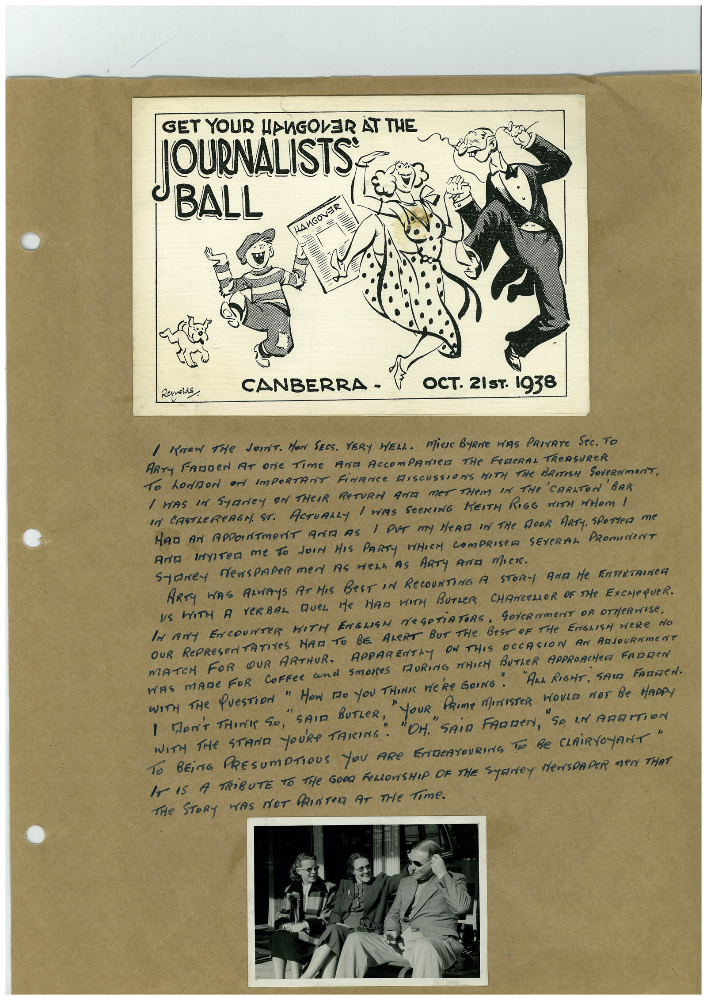

# Book 1 · scan 020

[Original scan](../../images/book-1/large/JPEG/BOOK1%20-%20021.jpg)

## Description

## Transcription

## Context

## Review notes

Compare the machine draft with the scan. Handwriting and names need human review.

## Artifacts

<!-- ARTIFACTS:START -->
Edit the artifacts field in this note’s frontmatter to change these records. This summary is generated.

### B01-S020-A01 — Newspaper clipping, Photo & Handwritten note — Book 1, scan 020

Types: Newspaper clipping, Photo, Handwritten note

Scope: Whole scanned page; individual items can be split out during review.

Caption: Not mapped yet.

Caption source: Not recorded yet.

Caption status: unmapped
<!-- ARTIFACTS:END -->

## Machine transcription

<!-- OCR:START -->
GET YOUR HANGOVER AT THE
JOURNALISTS
BALL
HANGOVER
Reynolds,
CANBERRA -
OCT. 21 ST. 1938
I Knew THe JorT. Mon SECS. YERY WELL. MiCIS BYRNE WAS PRIATE SeC. TO
ARTy FARDeN AT ONe TimE ANA ACCOmPANeR THe FeReRAL TREASUReR
To LOMON or ImPORTANT FiNANCe DISCUSSIONS WITH THe BRITISH SOVeRNmeNT,
I WAS IN STAReY ON THEIR ReTURN GIE MET THEM IN THe CARLTON ' BAR
IN CASTLeRAGN. ST. ACTUALLY / WAS SECKING KEITH RIGG WITH WHOM I
MAD AN APPOINTMENT ANTA AS I OUT MA HeAD IN THe DOOR ARTy. SPOTTeD me
ArA INyIten me to doIN HIS PARTy VHICH COmPRISED SEYeRAL PROmINeNT
Saney NewspapeR ment ds wens as ARry ANa mick.
ARTy WAS ARRYS AT HAS BeST IN RECOUNTING A STOR- AND He RNTERTRINCH
US WITH A VERBAL QUEL Me HAD WITH BUTLER CHANCELIOR OF THe ExCHeQUeR.
IN ANY ENCOUNTER WITH ENGLISH NEGOTiATORS, GOVERNmeNT OR OTHeRWISE,
OUR RePRESeNTATIVES HAT TO BE ALeRT BUT THe BeST OF THe ENGLISH HERe NO
MATCH FOR OUR ARTHUR. APPARENTLY ON THIS DECASION AN ARSOURNMENT
WAS mADe FoR CoFfee and Smores DURING WHICH BUTLeR APPROACHerT FADDeN
WITH THe QUESTION " HOW MO YOU THINK WE'Re GOING ".
"Ana RIGHT. SAIR FATIMEN.
I DON'T THINK SO,
PRIme MArISTER WOULD NOT Be HADRY
WITH THe STAND YOURe FARING.
TO BEiNG PRESUmPTIOUS YOU ARE ENDEATOURING TO Be CLAiRYOYANT"
IT IS A TRiBUTE TO THe GOOD FeLLOWSHIP OF THE SYRNEY NeWSPAPER MeN THAT
THe STORy WAS NOT PRINTeR AT THe Time.
<!-- OCR:END -->
