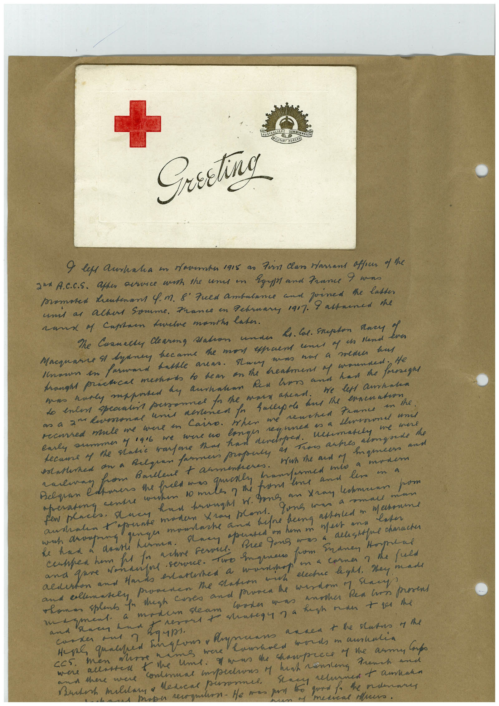

# Book 1 · scan 021

[Original scan](../../images/book-1/large/JPEG/BOOK1%20-%20022.jpg)

## Description

## Transcription

## Context

## Review notes

Compare the machine draft with the scan. Handwriting and names need human review.

## Artifacts

<!-- ARTIFACTS:START -->
Edit the artifacts field in this note’s frontmatter to change these records. This summary is generated.

### B01-S021-A01 — Greeting card & Handwritten note — Book 1, scan 021

Types: Greeting card, Handwritten note

Scope: Whole scanned page; individual items can be split out during review.

Caption: Not mapped yet.

Caption source: Not recorded yet.

Caption status: unmapped
<!-- ARTIFACTS:END -->

## Machine transcription

<!-- OCR:START -->
Greeting
9 les Acrinalia in saventas 1915 as fin Class Harrant affecr of the
2 A.C.C.S. after arce wish the uns in Egypt and France I wans
mamases deutenant 4. m. 8" Fued ambulance and joined the latter
unt as achas Somme. France in February 1907.
rama 4 Captan tavele months later.
I assauned the
Me Cranally daring Mation under Li. Cal. Srupton Ances Yes
Macquare & lynney became the mon epaent unes of is Hand.
Unsun en farward babble areas. Huer
mum nas a mena hus
tomost practical mestads to hear on the headment of wounded negl
do enter specialis personnel for the mars arend.
we left amanha
roused mule me were in Cairo. When me
renched France in the.
carly ammmer y 196 we were wo
recame M the natic wantone than han
Congreen as a throned und
кентанем
me wee
satired an a Reloan farmers propula
Troo artes
almasede the
alman from Barlent t armentores.
maneers and
eratna centre couton 10 ma
havers the felt was gen the from me and less on a
had brought w. pons an tray lamann pom
and tone moto ran plant. lone ens a smale mun
west and later
Bree fung was a delistsful character
in a corner 7 the full
and ellenasely provenen te saton wh
elecas hght, they made
Thomas splen fo thigh cases and prosen the wisdom y say
caster mas another Rea too prosens
сока нил ?
were kims were
were alaster t the une. I mas the champrace y me army Cupo
and there were continuas impedions of hush vening French and
Berth maliary o Medical persomel
metical speero
<!-- OCR:END -->
