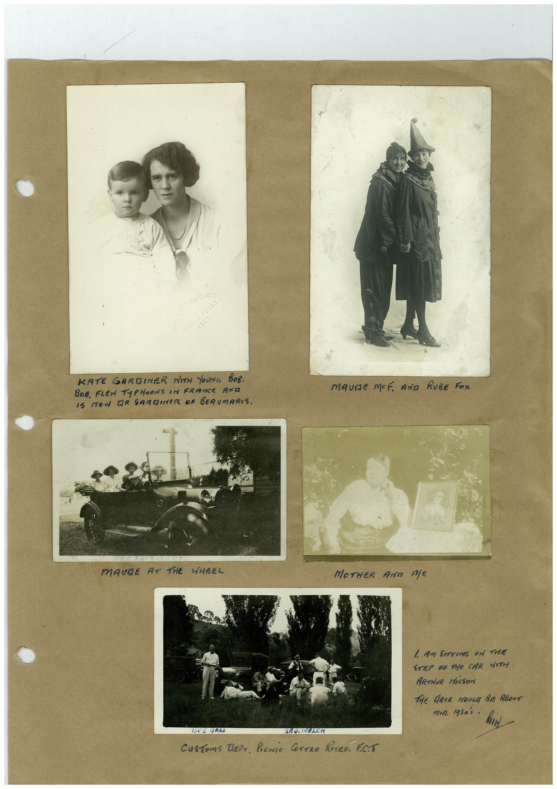

# Book 1 · scan 022

[Original scan](../../images/book-1/large/JPEG/BOOK1%20-%20023.jpg)

## Description

## Transcription

## Context

## Review notes

Compare the machine draft with the scan. Handwriting and names need human review.

## Artifacts

<!-- ARTIFACTS:START -->
Edit the artifacts field in this note’s frontmatter to change these records. This summary is generated.

### B01-S022-A01 — Photo & Handwritten note — Book 1, scan 022

Types: Photo, Handwritten note

Scope: Whole scanned page; individual items can be split out during review.

Caption: Not mapped yet.

Caption source: Not recorded yet.

Caption status: unmapped
<!-- ARTIFACTS:END -->

## Machine transcription

<!-- OCR:START -->
STUDIOS
KATE GARDINER WITH YOUNG BOB.
BOB. FLEW TyPHOONS IN FRANCE AND
IS MON DR SARDINER OF BERUMARIS.
MAUMe MOF ANa RUBE FoX
MAURE AT THE WHEEL
MOTHER ANa ne
1 AM SITTING ON THE
STEP OF THe CAR WITH
ARTHUR FiRSON
THE GATE HOULA BE ABOUT
mia. 1930's .
1506
TO. HERCH
CuSToms TEPT. PICNiC COTTER RIVER FET
<!-- OCR:END -->
