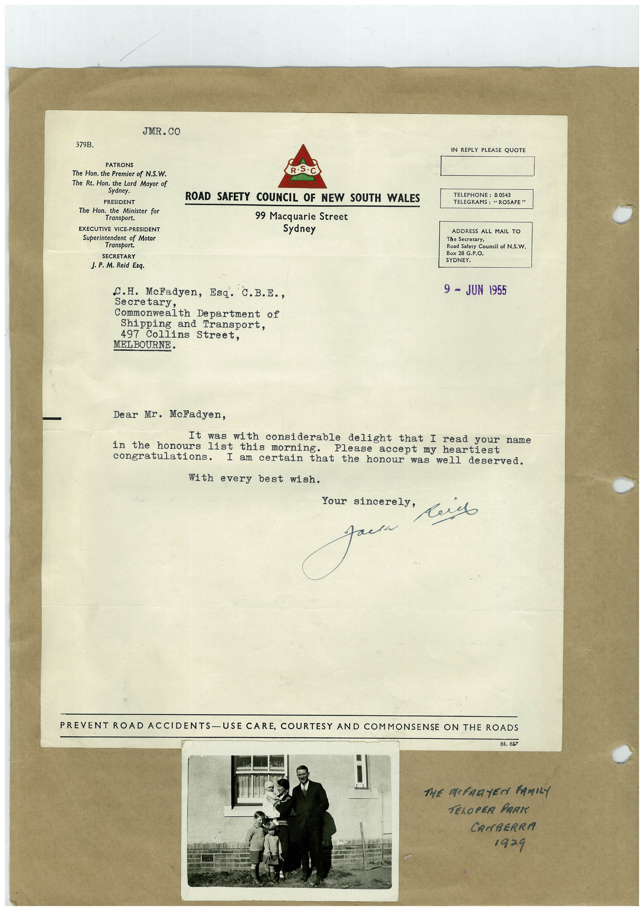

# Book 1 · scan 023

[Original scan](../../images/book-1/large/JPEG/BOOK1%20-%20024.jpg)

## Description

## Transcription

## Context

## Review notes

Compare the machine draft with the scan. Handwriting and names need human review.

## Artifacts

<!-- ARTIFACTS:START -->
Edit the artifacts field in this note’s frontmatter to change these records. This summary is generated.

### B01-S023-A01 — Letter, Photo & Handwritten note — Book 1, scan 023

Types: Typed document, Letter, Photo, Handwritten note

Scope: Whole scanned page; individual items can be split out during review.

Caption: Not mapped yet.

Caption source: Not recorded yet.

Caption status: unmapped
<!-- ARTIFACTS:END -->

## Machine transcription

<!-- OCR:START -->
JMR. CO
379B.
IN REPLY PLEASE QUOTE
PATRONS
The Hon. the Premier of N.S.W.
The Rt. Hon. the Lord Mayor of
Sydney.
PRESIDENT
The Hon. the Minister for
Transport.
EXECUTIVE VICE-PRESIDENT
Superintendent of Motor
Transport.
SECRETARY
J. P.M. Reid Esq.
C.H. McFadyen, Esq. C.B.E.,
Secretary,
Commonwealth Department of
Shipping and Transport,
497 Collins Street,
MELBOURNE.
ROAD SAFETY COUNCIL OF NEW SOUTH WALES
99 Macquarie Street
Sydney
TELEPHONE: B 0543
TELEGRAMS: " ROSAFE "
ADDRESS ALL MAIL TO
The Secretary,
Road Safety Council of N.S.W.
Box 28 G.P.O.
SYDNEY.
9 - JUN 1955
Dear Mr. McFadyen,
It was with considerable delight that I read your name
in the honours list this morning.
Please
accept my heartiest
congratulations. I am certain that the honour was well deserved.
With every best wish.
Your sincerely,
PREVENT ROAD ACCIDENTS-USE CARE, COURTESY AND COMMONSENSE ON THE ROADS
St. 857
THE MFARYER FAMILY
TELOPER PARI
CANBERRA
1929
<!-- OCR:END -->
