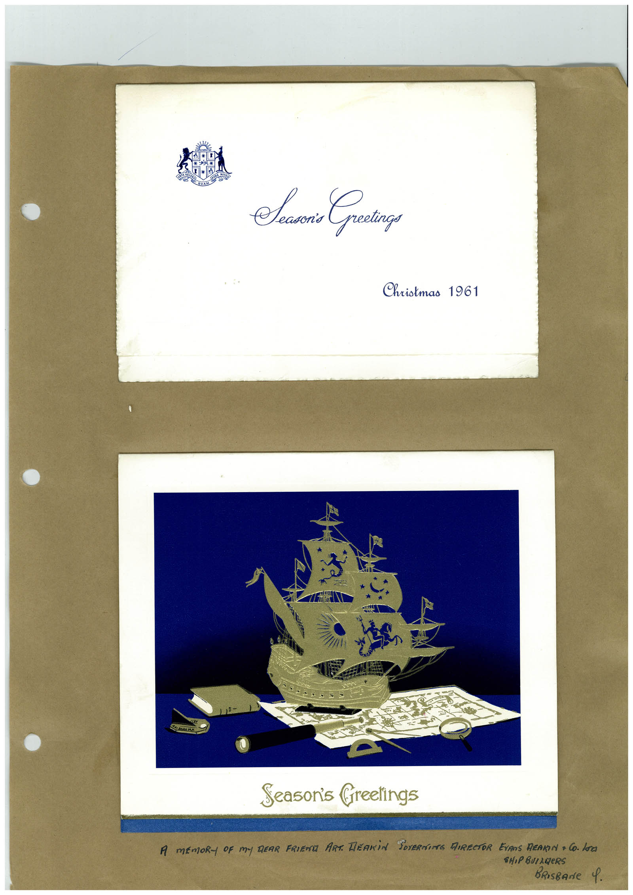

# Book 1 · scan 024

[Original scan](../../images/book-1/large/JPEG/BOOK1%20-%20025.jpg)

## Description

## Transcription

## Context

## Review notes

Compare the machine draft with the scan. Handwriting and names need human review.

## Artifacts

<!-- ARTIFACTS:START -->
Edit the artifacts field in this note’s frontmatter to change these records. This summary is generated.

### B01-S024-A01 — Greeting card — Book 1, scan 024

Types: Greeting card

Scope: Whole scanned page; individual items can be split out during review.

Caption: Not mapped yet.

Caption source: Not recorded yet.

Caption status: unmapped
<!-- ARTIFACTS:END -->

## Machine transcription

<!-- OCR:START -->
Seen Creatinge,
Christmas 1961
Season's Greetings
A MEMORY OF My DEAR FRIEND ART. HEARiN SOVERE IRRETOR EVANS REARIN + CO. LOO
BRIsBANe 9.
<!-- OCR:END -->
