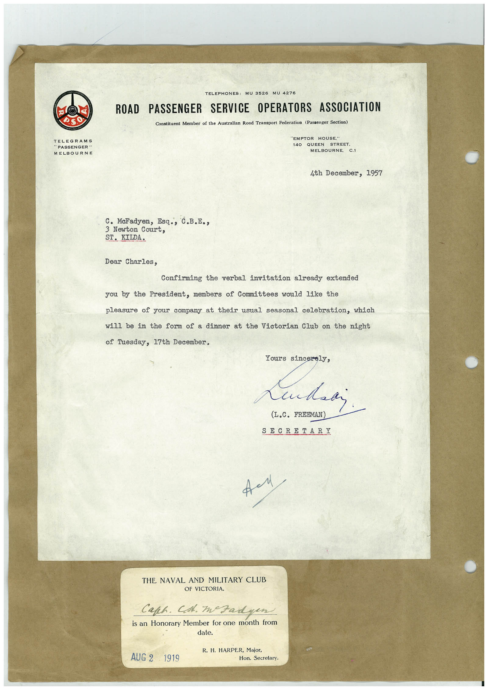

# Book 1 · scan 025

[Original scan](../../images/book-1/large/JPEG/BOOK1%20-%20026.jpg)

## Description

## Transcription

## Context

## Review notes

Compare the machine draft with the scan. Handwriting and names need human review.

## Artifacts

<!-- ARTIFACTS:START -->
Edit the artifacts field in this note’s frontmatter to change these records. This summary is generated.

### B01-S025-A01 — Letter & Handwritten note — Book 1, scan 025

Types: Typed document, Letter, Handwritten note

Scope: Whole scanned page; individual items can be split out during review.

Caption: Not mapped yet.

Caption source: Not recorded yet.

Caption status: unmapped
<!-- ARTIFACTS:END -->

## Machine transcription

<!-- OCR:START -->
TELEGRAMS
"PASSENGER "
MELBOURNE
TELEPHONES: MU 3526
ROAD PASSENGER SERVICE OPERATORS ASSOCIATION
Constituent Member of the Australian Road Transport Federation (Passenger Section)
"EMPTOR HOUSE,"
140
QUEEN
STREET.
MELBOURNE,
C.1
4th December, 1957
C. MeFadyen, Esq., C.B.E.,
3 Newton Court,
ST. KILDA.
Dear Charles,
Confirming the verbal invitation already extended
you by the President, members of Committees would like the
pleasure of your company at their usual seasonal celebration, which
will be in the form of a dinner at the Victorian Club on the night
of Tuesday, 17th December.
Yours sincerely,
(L.C. FREEMAN)
SECRETARI
THE NAVAL AND MILITARY CLUB
OF VICTORIA.
Caph. Cst. Izadyen
is an Honorary Member for one month from
AUG 2
1919
R. H. HARPER, Major,
Hon. Secretary.
<!-- OCR:END -->
