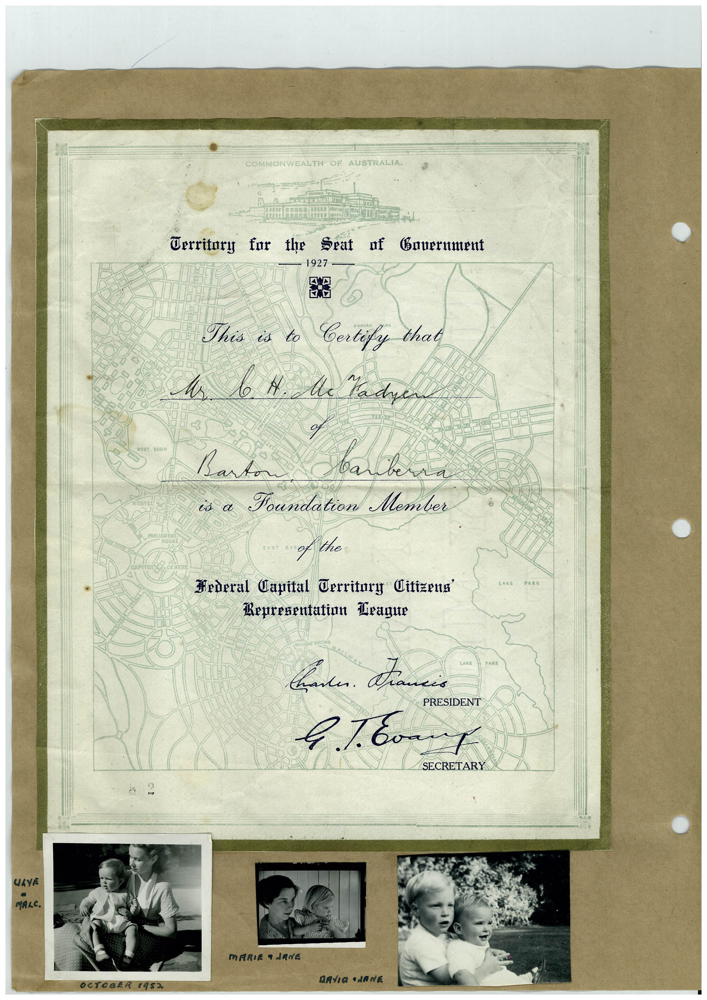

# Book 1 · scan 027

[Original scan](../../images/book-1/large/JPEG/BOOK1%20-%20028.jpg)

## Description

## Transcription

## Context

## Review notes

Compare the machine draft with the scan. Handwriting and names need human review.

## Artifacts

<!-- ARTIFACTS:START -->
Edit the artifacts field in this note’s frontmatter to change these records. This summary is generated.

### B01-S027-A01 — Certificate, Photo & Handwritten note — Book 1, scan 027

Types: Certificate, Photo, Handwritten note

Scope: Whole scanned page; individual items can be split out during review.

Caption: Not mapped yet.

Caption source: Not recorded yet.

Caption status: unmapped
<!-- ARTIFACTS:END -->

## Machine transcription

<!-- OCR:START -->
COMMONWEALTH OF AUSTRALIA.
Cerritory for the
Seat of Bauernment
1927
Mr
This is to Certify that
b. N. Me Kadyen
of
Barton
вал
is a Foundation Member
Hederal Capital Territury Citizena'
Representation Drague
TAKE
PARK
вали. Палів
PRESIDENT
SECRETARY
UAYA
MALC.
MARIE a JANE
MAVIO •JANE
OCTOBER
1952
<!-- OCR:END -->
