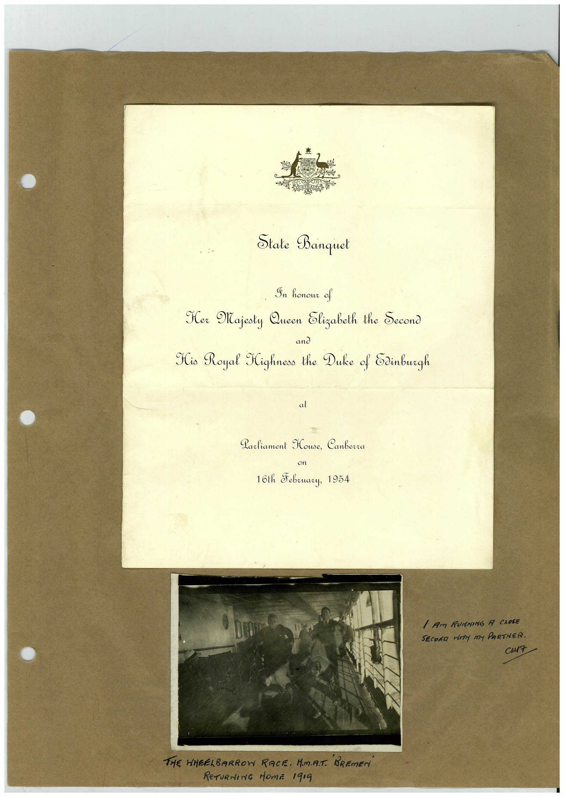

# Book 1 · scan 028

[Original scan](../../images/book-1/large/JPEG/BOOK1%20-%20029.jpg)

## Description

## Transcription

## Context

## Review notes

Compare the machine draft with the scan. Handwriting and names need human review.

## Artifacts

<!-- ARTIFACTS:START -->
Edit the artifacts field in this note’s frontmatter to change these records. This summary is generated.

### B01-S028-A01 — Invitation, Photo & Handwritten note — Book 1, scan 028

Types: Invitation, Photo, Handwritten note

Scope: Whole scanned page; individual items can be split out during review.

Caption: Not mapped yet.

Caption source: Not recorded yet.

Caption status: unmapped
<!-- ARTIFACTS:END -->

## Machine transcription

<!-- OCR:START -->
State Banquet
Sn honour of
Ker Majesty Queen Elizabeth the Second
His Royal Kighness the Duke of Edinburgh
al
Larliament House, Canberra
on
16th Jebruary, 1954
1 AM RUNNING A CROSE
SECOND MITY my PARTNER.
curt
THE WHEELBARROW RACE. HM.A.T. 'BREmEri
RETURNING MOME 19I9
<!-- OCR:END -->
