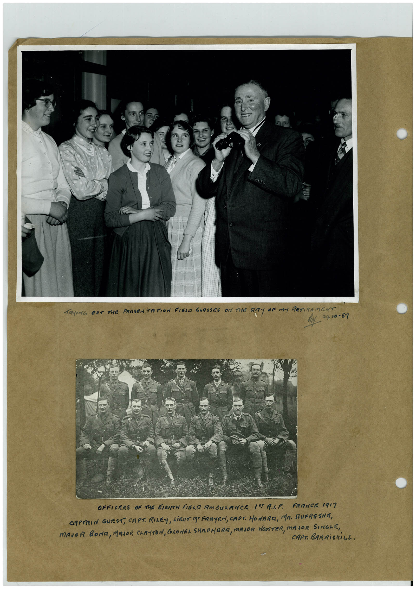

# Book 1 · scan 029

[Original scan](../../images/book-1/large/JPEG/BOOK1%20-%20030.jpg)

## Description

## Transcription

## Context

## Review notes

Compare the machine draft with the scan. Handwriting and names need human review.

## Artifacts

<!-- ARTIFACTS:START -->
Edit the artifacts field in this note’s frontmatter to change these records. This summary is generated.

### B01-S029-A01 — Photo & Handwritten note — Book 1, scan 029

Types: Photo, Handwritten note

Scope: Whole scanned page; individual items can be split out during review.

Caption: Not mapped yet.

Caption source: Not recorded yet.

Caption status: unmapped
<!-- ARTIFACTS:END -->

## Machine transcription

<!-- OCR:START -->
TRYING OUT THE PRESENTATION FIELD GLASSES ON THE DAY OF MY RETIREMENT
29.10-57
OFFICERS OF THE EIGHTH FIELD AMBULANCE / AIF FRANCE 1917
CAPERIN GURST, CAPT. RILEY, LIEUT MOFADYEN, CAPT. HOWARE, MR. RUFRESNE,
MAJOR BONA, MAJOR CLAYTON, COLONEL SHEPHERD, MAJOR WOOSTER, MAJOR SINGLE,
CAPT. BARRiSKILL.
<!-- OCR:END -->
