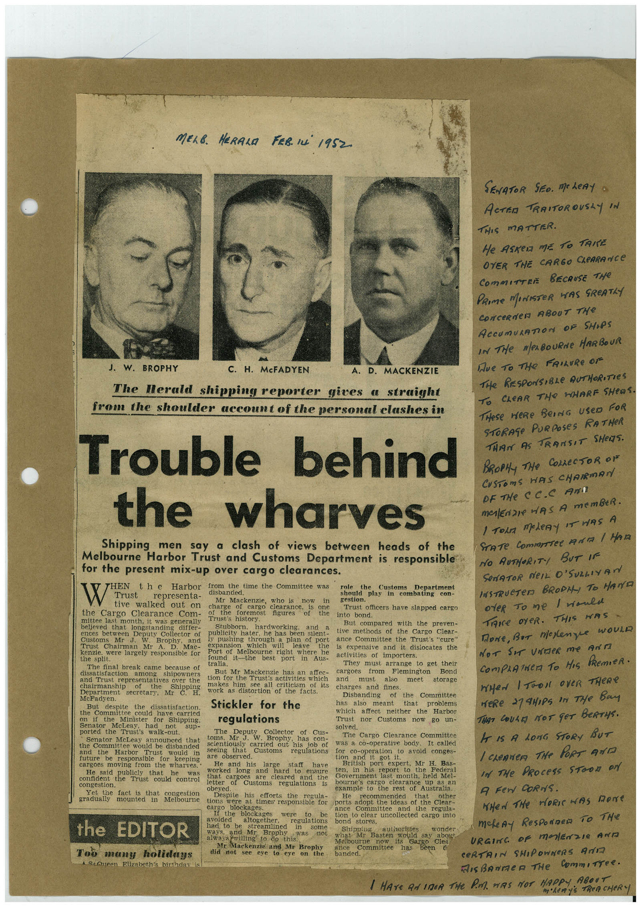

# Book 1 · scan 030

[Original scan](../../images/book-1/large/JPEG/BOOK1%20-%20031.jpg)

## Description

## Transcription

## Context

## Review notes

Compare the machine draft with the scan. Handwriting and names need human review.

## Artifacts

<!-- ARTIFACTS:START -->
Edit the artifacts field in this note’s frontmatter to change these records. This summary is generated.

### B01-S030-A01 — Newspaper clipping & Handwritten note — Book 1, scan 030

Types: Newspaper clipping, Handwritten note

Scope: Whole scanned page; individual items can be split out during review.

Caption: Not mapped yet.

Caption source: Not recorded yet.

Caption status: unmapped
<!-- ARTIFACTS:END -->

## Machine transcription

<!-- OCR:START -->
MELB. HERALA FER. IN 1952.
J. W. BROPHY
C. H. McFADYEN
A. D. MACKENZIE
The Herald shipping reporter gives a straight
from the shoulder account of the personal clashes in
Trouble behind
the wharves
Shipping men say a clash of views between heads of the
Melbourne Harbor Trust and Customs Department is responsible
for the present mix-up over cargo clearances.
THEN
the Harbor
from the time the Committee was
role
the
Custems
W
Department
Trust
representa-
disbanded.
tive walked out on
Mr Mackenzie,
who is
now
in
should play in combating
con-
gestion.
charge
of
cargo clearance,
the Cargo Clearance Com-
or use toremost
is
one
Trust officers have slapped cargo
figures
of
the
into bond.
mittee last month, it was generally
Trust's history.
believed that longstanding differ-
Stubborn.
hardworking,
and
But compared with the preven-
ences between Deputy Collector of
Customs
Mr J.
W.
Brophy,
and
publicity hater, he has been silent-
tive methods of the Cargo Clear-
ly pushing through a plan of port
ance Committee the Trust's "cure"
Trust Chairman Mr A.
Mac-
kenzie. were largely responsible for
expansion
which
will
leave
the
is expensive and it dislocates the
Port of Melbourne right where he
the split.
found it-the best port in Aus-
activities of importers.
The final break came because of
tralia.
They must arrange to get their
among
shipowners
But Mr Mackenzie has an affec-
cargoes from Flemington
Bond
and Trust representatives over the
tion for the Trusts activities which
and
must
also
meet
storage
of
makes him
see all criticism of its
Department
secretary, Mr
work as distortion of the facts.
charges and fines.
McFadyen.
of the Committee
But despite the
dissatisfaction.
Stickler for the
Disbanding
has also meant
that
problems
the Committee could have carried
which affect neither the Harbor
on if the
Minister
for
Shipping,
regulations
Trust nor Customs now go un-
Senator
McLeay.
had
sup-
selved.
ported the Trust's walk-out.
The
Deputy
Collector
of Cus-
Senator McLeay announced that
toms.
Mr
J.
W.
Brophy,
has
con-
The Cargo Clearance Committee
the Committee would be disbanded
Harbor
Trust
would in
seeing that
Customs
for co-operation to avoid conges-
future be responsible
for
keeping
regulations
was a co-operative body,
It called
are observed.
got it.
cargoes moving from the wharves.
He and his large
staff
have
British port expert, Mr H. Bas-
He said
publicly that
he
worked long and
hard to ensure
ten, in his report to
the
Federal
content the Trust could control
congestion.
letter cargoes
are cleared
and the
letter
Customs
Government last month, held Mel-
regulations
bourne's cargo clearance
obeyed.
example to the rest of
Yet the fact is that
congestion
Australia.
gradually
mounted mn Melbouine
Despite his efforts the
regula-
He
recommended
that
other
tions were at times responsible for
bolts acoot the ideas of the clear.
bleckages.
Call the blockages were to
be
Committee
and the regula-
tion to clear uncollected cargo into
the EDITOR
avoided
altogether,
regulations
bond stores.
had to be
Swear med
in
some
ways,
and Mr
Brophy
was
not
always willing to do this.
Too many holidays
1 SeAneen Elizabeth's birthday is
Mr Mackenzie and Mr Brophy
did not see eye to eye on
what
Mr
Melbourne
ance
Committee
banded.
would say abou
its
Sargo Clea
has
SENATOR SEO. MOLeRy o
ACTER TRAITOROUSAY IN
THIS MATTER.
He ASReA ME TO TANE
OVER THE CARGO CLeARANCE
COmMITTEE BECAUSE THe
PRIme MeNISTeR WAS SReATLY
CONCeRNeR ABOUT THe
ACCUmULATION OF SHIPS
IN THe Mes BOURNe HARBOUR
Де то THe FRILURe OF
THe RESPONSIBLe AUTHORITIES
TO CLEAR THe HHARF SHeOS.
THeSe HERe BeING USeD FOR
STORAGe PURPOSeS RATHeR
THAN AS TRANSIT SHeS.
BROPHy THe COLLECTOR OV
CUSTOmS HAS CHAIRMAN
OF THe CC.C AnT
MAlEriZe HAS A memBeR.
1 Torn meteRy iT wAS A
NO AUTHORITY BUT IF
SeNATOR NeIL O'SULLIVAN
INSTRUCTeD BRODI, TO HAND
oteR To me I would
TRIce OYeR. THIS WAS
Done, BuT melenge woulD
NoT Sir UndeR me Arri
COmPLATNeR TO HIS PRemIeR.
WHeN I TOOK OVeR THERe
weRe 279H,Ps in THe Bay
THAT COULD NOT GOT BERTyS.
IT IS A LONG STORY BUT
I chenNeR THe PORT ANT
In The PRocess SToon oN
A Fen CoRNS.
WHeN The HORIwAS Done
makeAy ResponDen To THe
URGINC oF malEnzIe AND
CERTAIN SHIPOWNeRS AND
MIsBonmeR THe CommiTTee.
I HATE AN INCA THe PA HAS NOT HAPPY ABOUT
<!-- OCR:END -->
