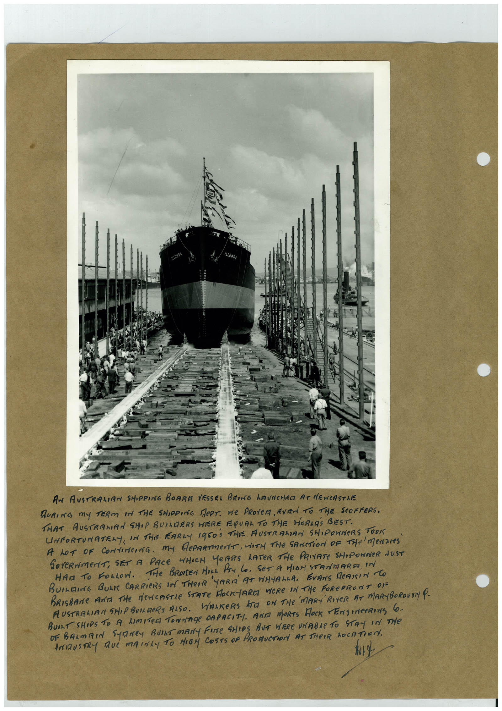

# Book 1 · scan 031

[Original scan](../../images/book-1/large/JPEG/BOOK1%20-%20032.jpg)

## Description

## Transcription

## Context

## Review notes

Compare the machine draft with the scan. Handwriting and names need human review.

## Artifacts

<!-- ARTIFACTS:START -->
Edit the artifacts field in this note’s frontmatter to change these records. This summary is generated.

### B01-S031-A01 — Photo & Handwritten note — Book 1, scan 031

Types: Photo, Handwritten note

Scope: Whole scanned page; individual items can be split out during review.

Caption: Not mapped yet.

Caption source: Not recorded yet.

Caption status: unmapped
<!-- ARTIFACTS:END -->

## Machine transcription

<!-- OCR:START -->
AN AUSTRALIAN SHIPPING BOARA VESSEL BEING hAUNCHEM AT dEWCASTRE
DURING My TERM IN THE SHIPPING MePT. He PROVEM, EVEN TO THE SCOFFERS,
THAT AUSTRAMIAN SHIP BUILDERS WERE EQUAL TO THE HORNES BEST.
UNFORTUNATELY, IN THE EARLY 1950S THIS AUSTRALIAN SHIPONNERS TOOK
A LOT oF CoNtiricing. My dePARTmeriT, WITH THe SANCTiOn OF THe meNares
GOVeRNmeNT, SET A PACE WHICH YeARS LATER THe PRIVATE SHIPOWNER NUST
HAT TO FOLLON. THe BROREN MILL PAY LO. SET A MIGN STAMMARE IN
BUILDING BUL CARRiERS IN THEIR YARD AT FiNALLA. EVANS MeANIN TO
BUILT SHIPS TO A LIMITED TONNAGe CAPACITY. ANTA MORTS ROCK ENGINeERINg 6.
OF BARmAIN SANEy BUlAT mANY FINe SHIpS BUT WERe UNABLe TO STAy In THe
ANIZUSTRY RUE MAINLY TO HIGM COSTS OF PROMUCTION AT THeIR hOCATION,
<!-- OCR:END -->
