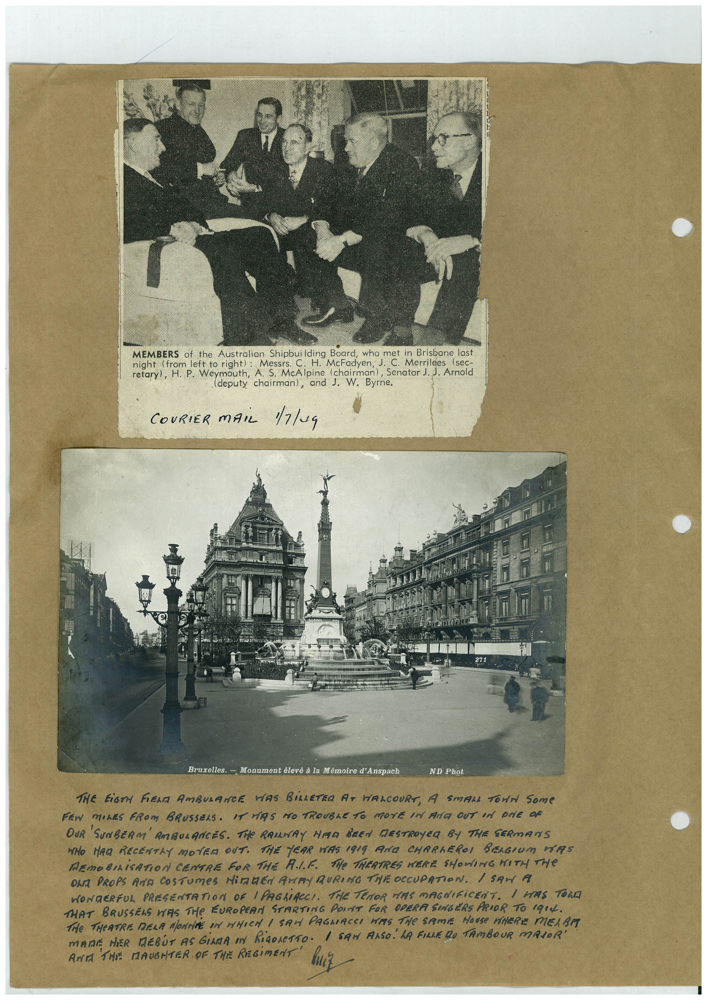

# Book 1 · scan 033

[Original scan](../../images/book-1/large/JPEG/BOOK1%20-%20034.jpg)

## Description

## Transcription

## Context

## Review notes

Compare the machine draft with the scan. Handwriting and names need human review.

## Artifacts

<!-- ARTIFACTS:START -->
Edit the artifacts field in this note’s frontmatter to change these records. This summary is generated.

### B01-S033-A01 — Newspaper clipping, Photo & Handwritten note — Book 1, scan 033

Types: Newspaper clipping, Photo, Handwritten note

Scope: Whole scanned page; individual items can be split out during review.

Caption: Not mapped yet.

Caption source: Not recorded yet.

Caption status: unmapped
<!-- ARTIFACTS:END -->

## Machine transcription

<!-- OCR:START -->
MEMBERS of the Australian Shipbuilding Board, who met in Brisbane last
night (from left to right) :
Messrs. C. H. McFadyen, J. C. Merrilees sec-
retary), H. P. Weymouth, A. S. McAlpine (chairman), Senator J. J. Arnold
. (deputy chairman), and J. W. Byrne.
COURIER MAiL 1/7/19
271
Bruxelles. - Monument élevé à la Mémoire d'Anspach
ND Phot
THE EiGTH FIENA AMBULANCE HAS BiLLETEA AT WALCOURT, A SMALL TOrN Some
PEN MINES FROM BRUSSEAS. IT MRS MO TROUBLE TO MOVE IN ANCA OUT IN ARE OF
OUR SUNBEAM' AMBULANCES. THe RAILWAY MIAD BEEN DESTROYCA BY THE SERMANS
WHO HAG RECENTLY MOTER DUT. THE YEAR HAS 19I9 AND CHARLEROI BEAGIUM HAS
REMOBILiSATION CENTRE FOR THE AlF. THe THEATRES WERE SHOWING WITH THe
OLA PROPS AND COSTUMES HiAMEN ARMY DURING THE OCCUPATION. I SAN A
WONDERFUL PREGENTATION OF | PAGLiACCI. THE TEMOR HAS MAGNIFICENT. I HAS TORO
THAT BRUSSELS WAS THE EUROPEAN STARTING POINT FOR OPERA SINGERS PRIOR TO 1914.
THe THeATRE RELA MONTRE IN WHICH ! SAN PAGHACCI WAS THe SAME HOUSe WHERE MELBR
MARE HER DEBÚT AS GIARA IN RIGORETTO. / SAN RASO. LA FILLE DU TAMBOUR MANOR'
ANN THE TAUGHTER OF THE REGIMENT
<!-- OCR:END -->
