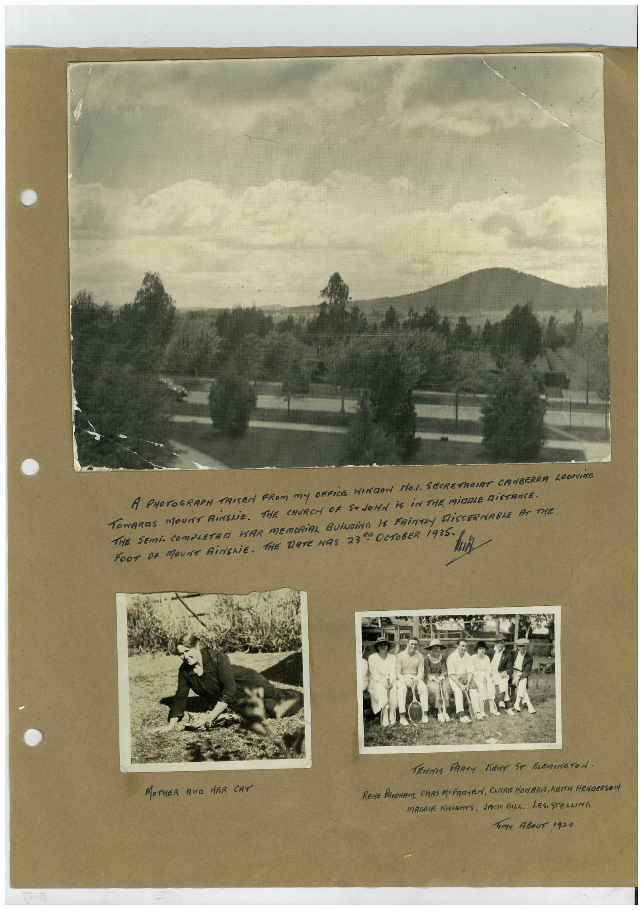

# Book 1 · scan 034

[Original scan](../../images/book-1/large/JPEG/BOOK1%20-%20035.jpg)

## Description

## Transcription

## Context

## Review notes

Compare the machine draft with the scan. Handwriting and names need human review.

## Artifacts

<!-- ARTIFACTS:START -->
Edit the artifacts field in this note’s frontmatter to change these records. This summary is generated.

### B01-S034-A01 — Photo & Handwritten note — Book 1, scan 034

Types: Photo, Handwritten note

Scope: Whole scanned page; individual items can be split out during review.

Caption: Not mapped yet.

Caption source: Not recorded yet.

Caption status: unmapped
<!-- ARTIFACTS:END -->

## Machine transcription

<!-- OCR:START -->
A PHOTOGRARM TRITEN FROM MY OFFICE MINION NO.1. SECRETARIAT CANBERRA LOOKING
TOWARDS MOUNT RiNSLiE. THE CHURCH OF STOOHA IS iN THE MiDDLE DiSTANCE.
THE SEMi- COMPRETER WAR MEMORIAL BUiLDiNG iS FRiNTRY DiSCERNABLE AT THE
FOOT DR MOUNT RiMERiE, THE TATE MAS 23%. OCTOBER 1985° MI
MOTHER AND HER CAT
TEMPTIS PARTY IENT ST FLEMINOTOA.
REnE PRIgHAM, CHAS MCFARYEN, CARRE HOMARA, KEITH HENRERSON
MRGGIE KNIGHTS, JACK GILL. LES.STELLING
Tome ABouT 19=0
<!-- OCR:END -->
