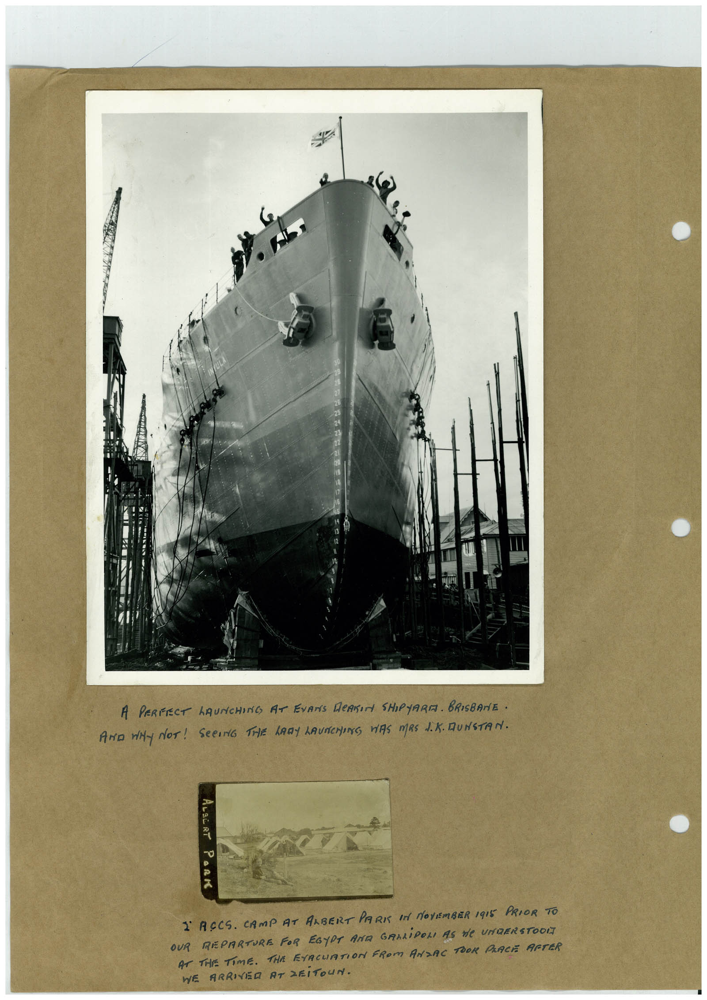

# Book 1 · scan 035

[Original scan](../../images/book-1/large/JPEG/BOOK1%20-%20036.jpg)

## Description

## Transcription

## Context

## Review notes

Compare the machine draft with the scan. Handwriting and names need human review.

## Artifacts

<!-- ARTIFACTS:START -->
Edit the artifacts field in this note’s frontmatter to change these records. This summary is generated.

### B01-S035-A01 — Photo & Handwritten note — Book 1, scan 035

Types: Photo, Handwritten note

Scope: Whole scanned page; individual items can be split out during review.

Caption: Not mapped yet.

Caption source: Not recorded yet.

Caption status: unmapped
<!-- ARTIFACTS:END -->

## Machine transcription

<!-- OCR:START -->
A PERFECT LAUNCHING AT EVANS DeARIN SHIPYARA. BRISBANE.
AND WHy NOT! SeeING THIE LADY LAUNCHING WAS MRS 1.K. RUNSTAN.
ALSiRT PARK
I ACCS. CAMP AT ALBERT PARI IN MOVISMBER 19I5 PRIOR TO
OUR REPARTURE FOR EGYPT ANA GARLiPON AS He UNDERSTOOR
AT THE TIME. THE EYACUATION FROM ANSAC TOOK PRACE AFTER
WE ARRIVED AT ZEiTOUN.
<!-- OCR:END -->
