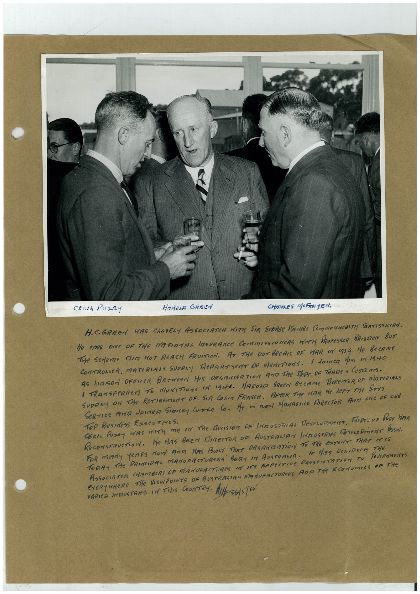

# Book 1 · scan 036

[Original scan](../../images/book-1/large/JPEG/BOOK1%20-%20037.jpg)

## Description

## Transcription

## Context

## Review notes

Compare the machine draft with the scan. Handwriting and names need human review.

## Artifacts

<!-- ARTIFACTS:START -->
Edit the artifacts field in this note’s frontmatter to change these records. This summary is generated.

### B01-S036-A01 — Photo & Handwritten note — Book 1, scan 036

Types: Photo, Handwritten note

Scope: Whole scanned page; individual items can be split out during review.

Caption: Not mapped yet.

Caption source: Not recorded yet.

Caption status: unmapped
<!-- ARTIFACTS:END -->

## Machine transcription

<!-- OCR:START -->
CECIL PUZE-
HAROLE GREEN
CHARLES N/FAN YEN.
H.C.GREEN HAS ChOSELY ASSOCIATER WITH SIR GEORGe INIBBS COmMONWCALTH STATISTICIAN.
He WAS ONe OF THe NATIONAL INSURANCE COmmISSIONERS WITH PROFESSOR BRISTEN BUT
THe Seeme FAIr NOT ReACH FRUITION. AT THe OUTBReAK OF ViAR IN 1939 He BecAme
CONTROLER, MATERIARS SUPPLY DePARTMENT OF MUNITIONS. / DOINeR HIM IN 1940
AS LIAISON OFFICER BETWEEN HIS ORGANISATION AND THe DePT. OF TRADE A CUSTOmS.
I TRANSFERRER TO MUNITIONS IN IGHA. HAROMA GREEN BECAMe HIReCTOR OF MATeRIRAS
SUpeRy ON THe RETIReMENT OF SIR COLIN FRASER. AFTeR THe HAR Ne LeFT THe SoiT.
SeRrIce AND Lorder Sianey Core Co. He as non MANAGING FIReCTOR ARE ONe DE DUA
ToP Business ExeCUTIvES.
CEcIL Posey WAS WITH me IN The divIsION OF INgUSTRIAL HereroPmenT. TeRr. DE PosT HAR
RECONSTRUCTiON. He NAS BEEN DIRECTOR OF AUSTRALIAN INEUSTRIES MereLOPmeNT ASSN.
FOR mANy YeARS NOW AND HAS BUNT THAT ORGANiSATiON TO THe ExTeNT THAT IT IS
TORAY THe PRINCIDAL MANUFACTUReRS BODY IN AUSTRAMA. H HAS ECLiPSEn
ASSOCIATER CHAMBeRS OF MANUFACTUReS IN ITS EFFECTIVe PReSenTATION TO PoVeRNmeNTS
EveRYWHeRe THe VIeWPOINTS OF AUSTRALIAN MANUFACTUReRS ArE THe ECONOmICS OF THe
VARIED INAUSTRIES IN THIS COUNTRY MI26/8165
<!-- OCR:END -->
