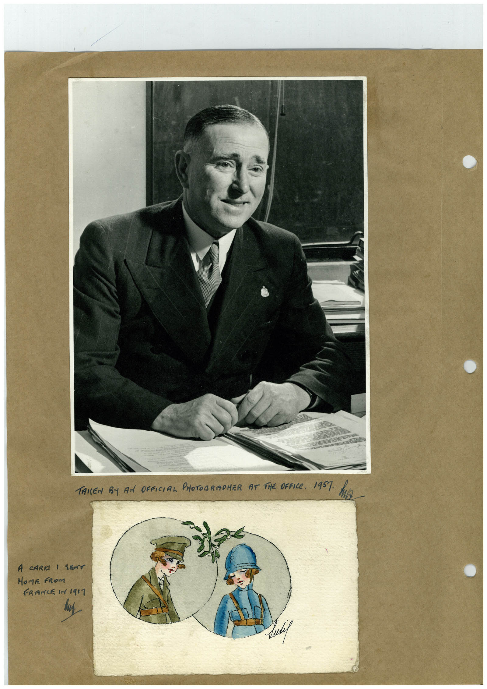

# Book 1 · scan 037

[Original scan](../../images/book-1/large/JPEG/BOOK1%20-%20038.jpg)

## Description

## Transcription

## Context

## Review notes

Compare the machine draft with the scan. Handwriting and names need human review.

## Artifacts

<!-- ARTIFACTS:START -->
Edit the artifacts field in this note’s frontmatter to change these records. This summary is generated.

### B01-S037-A01 — Photo, Greeting card & Handwritten note — Book 1, scan 037

Types: Photo, Greeting card, Handwritten note

Scope: Whole scanned page; individual items can be split out during review.

Caption: Not mapped yet.

Caption source: Not recorded yet.

Caption status: unmapped
<!-- ARTIFACTS:END -->

## Machine transcription

<!-- OCR:START -->
TALLEN BY AN OFFICIAL PHOTOGRAPHER AT THE DFACe. 1951 Mi
A CARTA 1 SENT
HOME FROm
FRANCE IN 1911
Lukef
<!-- OCR:END -->
