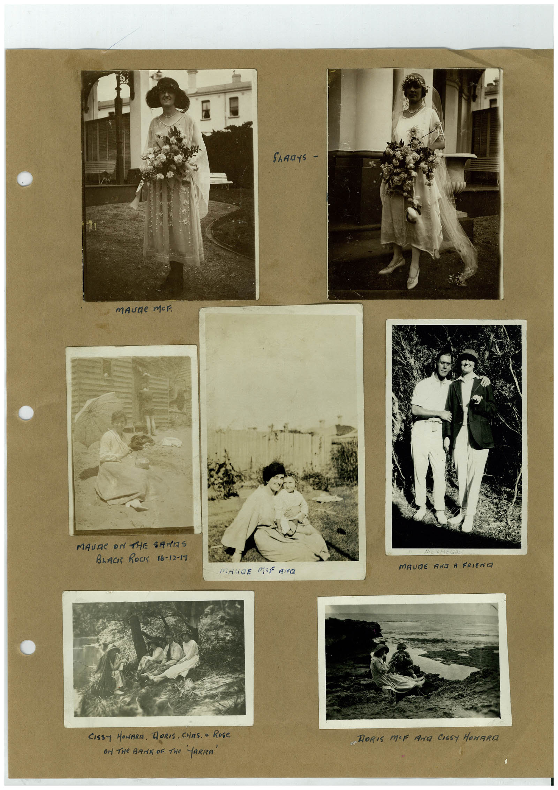

# Book 1 · scan 038

[Original scan](../../images/book-1/large/JPEG/BOOK1%20-%20039.jpg)

## Description

## Transcription

## Context

## Review notes

Compare the machine draft with the scan. Handwriting and names need human review.

## Artifacts

<!-- ARTIFACTS:START -->
Edit the artifacts field in this note’s frontmatter to change these records. This summary is generated.

### B01-S038-A01 — Photo & Handwritten note — Book 1, scan 038

Types: Photo, Handwritten note

Scope: Whole scanned page; individual items can be split out during review.

Caption: Not mapped yet.

Caption source: Not recorded yet.

Caption status: unmapped
<!-- ARTIFACTS:END -->

## Machine transcription

<!-- OCR:START -->
ShADYS -
MAURE ON THE SANAS
BLACK ROCK 16-12-11
MALUE PISE ANG
MAUDE AND A FRIEN
CISSY HOWARA, DORIS. CHAS. + Rose
ON THe BANK OF THe HARRA'
DORIS MOF AND CISSY HOWARD
<!-- OCR:END -->
