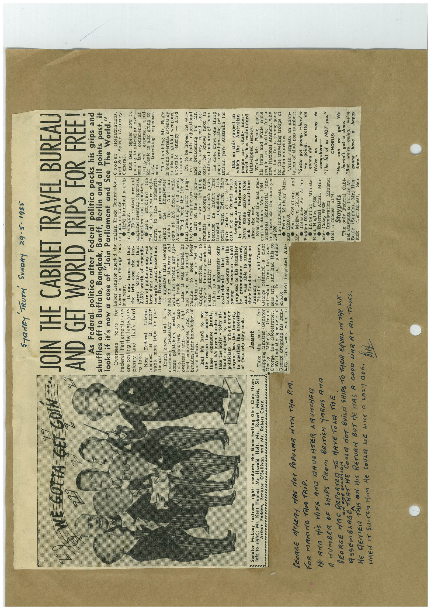

# Book 1 · scan 039

[Original scan](../../images/book-1/large/JPEG/BOOK1%20-%20040.jpg)

## Description

## Transcription

## Context

## Review notes

Compare the machine draft with the scan. Handwriting and names need human review.

## Artifacts

<!-- ARTIFACTS:START -->
Edit the artifacts field in this note’s frontmatter to change these records. This summary is generated.

### B01-S039-A01 — Newspaper clipping & Handwritten note — Book 1, scan 039

Types: Newspaper clipping, Handwritten note

Scope: Whole scanned page; individual items can be split out during review.

Caption: Not mapped yet.

Caption source: Not recorded yet.

Caption status: unmapped
<!-- ARTIFACTS:END -->

## Machine transcription

<!-- OCR:START -->
SHANEY TRUTH SUNDAY 29-5-1955
WE GOTTA GET GONN
Senator McLeay (extreme right) conducts the Globe-trotting Glee Club (from
left to right): Mr. Kent Hughes, Mr. Harold Holt,
Robert Menzies,
Arthur Fadden,
Senator O'Sullivan and Mr. Robert Casey.
.............
SEORGE MOLEY WAS dOT POPULAR MITH THE PM.
FOR MAKING THIS TRiP.
He AND HiS WIFE AND DAUGHTER ARUNCHED
A NUMBER OF SHIPS FROM BRITiSH YARDS ANIZ
JOIN THE CABINET TRAVEL BUREAU
AND GET WORLD TRIPS FOR FREE!
As Federal politico after Federal politico packs his grips and
Shoks it ifs told case of Join Part, ment and See phe world.
for Labor Senator queried the tralian Trade Commission- Cooper
(Repatriation.),
Federal Parliamentarians last year.
overseas trip George took er posts en route.
and Sen. Spicer (Attorney
He'd launched a ship General.
are costing the taxpayers
and that's hard
He'a trotted around
But Sen. Spicer now is
England meeting reporters, seas
packing to attend an over-
conference
at
ture of public money was
The tar: Beale is
expense
and
wants more trips for pol-
British food picture right draw
also going to
expenses
George's jaunt leaked out
Truth knows that it is
and presumably
It appeared that George
heard
the
housewives'
The bumbling Mr. Beale
extremely
necessary
had no set itinerary and
thanks
Australian
is bound overseas ostensibly
come politicians.
to discuss guided weapons,
atomic
larly
ministers,
particu- would not attend any spe-
take cific trade conference.
eggs at
Australians pay 6/3 dozen.
energy
- and
Trios
for high
Later it was learned he
• He'd been the life of
uranium.
level conferences and
to
had been sent abroad by
broaden their knowledge
of Cabinet
It's to be hoped the ven-
to
educational
world affairs.
freights and better
But it's hard to see
shipping services, and
the reason for some of
review preliminary work on
shipping Beale's sorry record sug-
knows
next
those expensive
jaunts,
better
publicity
and it's even harder to
tralian goods.
have lost his tourist's guide, nothing about any of them.
He does know one thing
ake the hoity, toity at-
It was apparently only
about uranium-the
price.
titude adopted by some
co-incidental
politicians
whenever
London
George met the
Britain pays Australia for
anyone has the temerity
young
Scotsman
to question the necessity
of that trin they took.
proposed to his daughter
But on this subject in
which
the
Australian
gramophone
George and his mates
in
Redlera
Parliament
oni une able to attand
Jaunt
their London wedding on
have made Marco Polo
look
strictly
small-time
people vita
January 1.
since the war.
tight-lipped secrecy.
Take
the case
of the
Shipping Minister (Senator
Finally, in mid-March,
Even since the last Fed-
While Mr.
Beale packs
George returned
a giant eral elections May, 1954
his traps and while some
George
George
McLeay)
Genial
the Globetrotter.
refreshed from his
over-
overseas Ministerial
people are looking for a
seas trip, and had this to
kets have cost the taxpayer new National Anthem, why
We had the spectacle of
664,920.
not look for a theme song
George dropping his geni-
£3510:
the
publie's
week
when
He'd inspected Aus-
The imme int costs en- for tan trains.
for the travelling troupe of
zies £22,000.
Truth suggests an adap-
• Sen.
O'Sullivan and
tation of that pop number:
Mr. McEwen €21,800.
• Treasurer Sir Arthur
Fadden £9000.
"Gotta get going, where're
going,
wotta
• Interior Minister
gonna do?
Kent Hughes £2600.
"We're
• External Affairs Min-
on our way to
somewhere—
ister Casey £5836.
• Immigration
Minister
"The lot of us NOT you."
Holt a modest $174.
CHORUS:
Stayputs
The only Federal Cabi-
"How can we go? We
GODD LiAR AT ALL TimES.
net stayputs so far are Mr.
haven't got a dime.
"But we're
we re
Beale
luck
(Supply), Mr. Has-
gonna
(Territories),
Sen.
time."
HE DENIER THIS ON HIS RETURN BUT ME HAS A
WHEN IT SUITED HIM ME COULD LIE LIKE A LA2- A0G.
<!-- OCR:END -->
