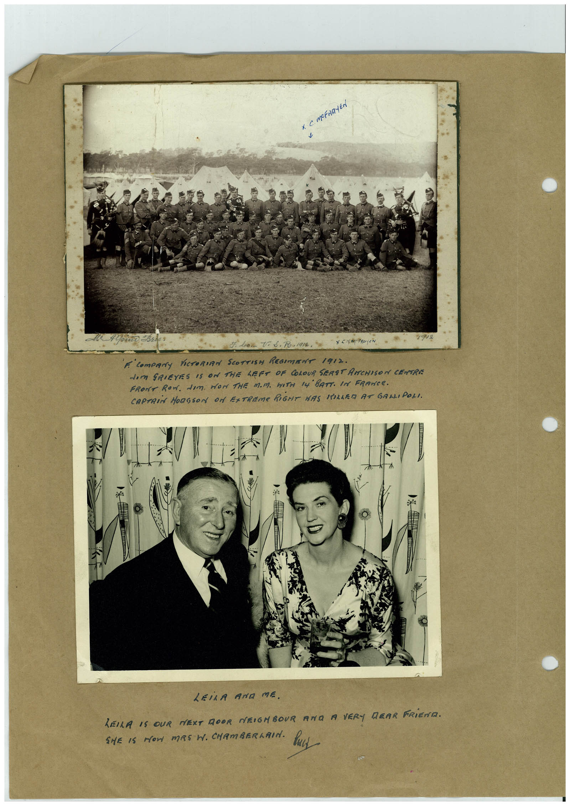

# Book 1 · scan 041

[Original scan](../../images/book-1/large/JPEG/BOOK1%20-%20042.jpg)

## Description

## Transcription

## Context

## Review notes

Compare the machine draft with the scan. Handwriting and names need human review.

## Artifacts

<!-- ARTIFACTS:START -->
Edit the artifacts field in this note’s frontmatter to change these records. This summary is generated.

### B01-S041-A01 — Photo & Handwritten note — Book 1, scan 041

Types: Photo, Handwritten note

Scope: Whole scanned page; individual items can be split out during review.

Caption: Not mapped yet.

Caption source: Not recorded yet.

Caption status: unmapped
<!-- ARTIFACTS:END -->

## Machine transcription

<!-- OCR:START -->
F. CompRy ViCTORIAN SCOTTISH REGIMENT 1912.
dom GRIEVES IS ON THE LEFT OF COLOUR SERST ANCHISON CENTRE
FRONT ROW. DIM. MON THE M.M. WITH Iy BATT. IN FRANCE.
CAPTAIN HODGSON ON EXTREME RIGHT HAS MILLER AT GALLIPOLI.
*1
LEiLA AND ME.
LEILA IS OUR NEXT DOOR NEIGHBOUR AND A VERY DRAR FRIEND.
SitE 15 NOW MRS W. CHAMBERMAIN. HU
<!-- OCR:END -->
