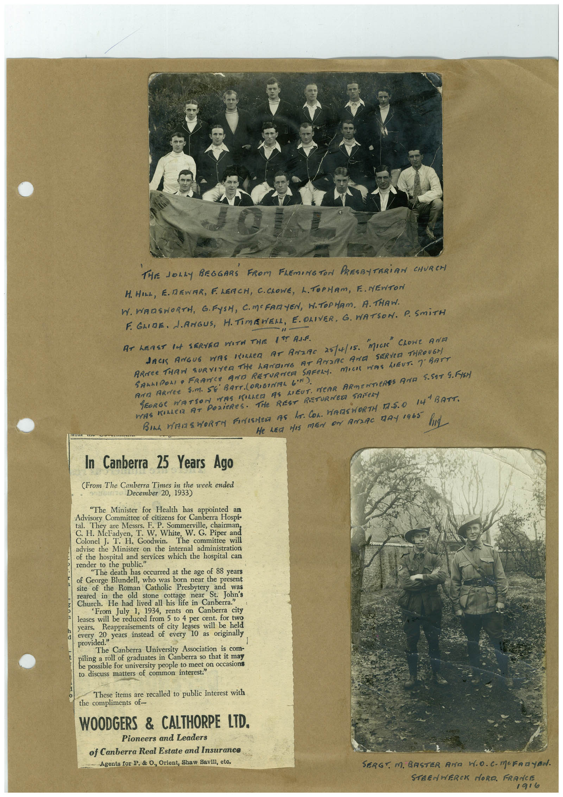

# Book 1 · scan 042

[Original scan](../../images/book-1/large/JPEG/BOOK1%20-%20043.jpg)

## Description

## Transcription

## Context

## Review notes

Compare the machine draft with the scan. Handwriting and names need human review.

## Artifacts

<!-- ARTIFACTS:START -->
Edit the artifacts field in this note’s frontmatter to change these records. This summary is generated.

### B01-S042-A01 — Newspaper clipping, Photo & Handwritten note — Book 1, scan 042

Types: Newspaper clipping, Photo, Handwritten note

Scope: Whole scanned page; individual items can be split out during review.

Caption: Not mapped yet.

Caption source: Not recorded yet.

Caption status: unmapped
<!-- ARTIFACTS:END -->

## Machine transcription

<!-- OCR:START -->
THE JOLLY BEGGARS FROM FLEMING TON PRESBYTERiAN CHURCH
H. HILL, E. REWAR, FLEACH, C.CROWE, L. TOPHAM, E. NEWTON
W. WARSWORTH, G. FYSH, C.MCFARYEN, W.TOPHAM, A. THAW.
F. GLIDE. LANGUS, H.TIMISWER, E. OLIVER, G. WATSON. P. SmiTH
AT LEAST lA SERVEO WITH THE 1?T ALF.
JACK ANGUE WAS KILLED AT ANZAC 25/4/15.
ARMEe THAN SURVIYER THe hANDING AT ANDAC ArCA
SERVED THROUGA
SASHIPOLI• FRANCE AND RETURNER SAFELY. MICH WAS LIEUT. 7 BATT
AND ARTEE SM. SE BATT. (ORIGINAL GIN).
GEORGE WATSON WAS KILLER AS LIEUT. NEAR ARMENTERES AND 5.597 9. FISH
WAS KALeR AT
PORTeReS. THe REST RETURNED SAFeRY
BILL WIZES WORTH FINISHED AS hE. COL. WASNORTH TZ.S.O I41 BATT.
He LEd HIS MEN ON AMDAC TAY 1965
In Canberra 25 Years Ago
(From The Canberra Times in the week ended
December 20, 1933)
"The Minister for Health has appointed an
Advisory Committee of citizens for Canberra Hospi-
al. They are Messrs. F. P. Sommerville, chairman
C. H. McFadyen, T. W. White, W. G. Piper and
Colonel J. T. H. Goodwin.
The committee will
advise the Minister on the internal administration
of the hospital and services which the hospital car
render to the public."
"The death has occurred at the age of 88 years
of George Blundell, who was born near the present
site of the le ma stone cic Pee hear t Jobs
reared in the old stone cottage
Church. He had lived all his life in Canberra."
From July 1, 1934, rents on Canberra city
leases will be reduced from 5 to 4 per cent. for two
years.
Reappraisements of city leases will be held
every 20-
provided years instead of every 10 as originally
The Canberra University Association is com-
iling a roll of graduates in Canberra so that it may
e possible for university people to meet on occasion
to discuss matters of common interest."
These items are recalled to public interest with
the compliments of-
WOODGERS & CALTHORPE LTD.
Pioneers and Leaders
of Canberra Real Estate and Insurance
Agents for P. & O., Orient, Shaw Savill, etc.
SERGY M. BASTER ANa H.O. C-MCFRayBH.
STRENWERCK MORA. FRANCE
1916
<!-- OCR:END -->
