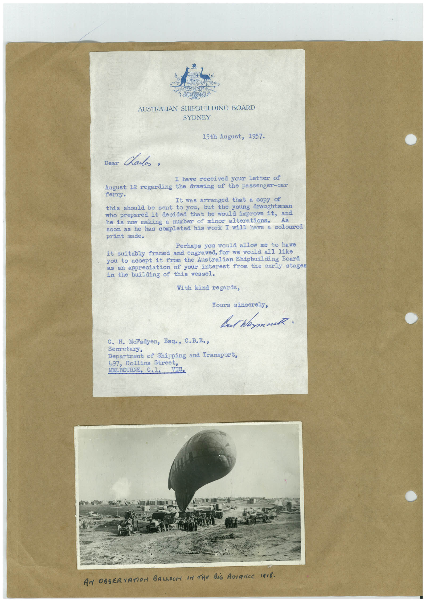

# Book 1 · scan 043

[Original scan](../../images/book-1/large/JPEG/BOOK1%20-%20044.jpg)

## Description

## Transcription

## Context

## Review notes

Compare the machine draft with the scan. Handwriting and names need human review.

## Artifacts

<!-- ARTIFACTS:START -->
Edit the artifacts field in this note’s frontmatter to change these records. This summary is generated.

### B01-S043-A01 — Letter, Photo & Handwritten note — Book 1, scan 043

Types: Typed document, Letter, Photo, Handwritten note

Scope: Whole scanned page; individual items can be split out during review.

Caption: Not mapped yet.

Caption source: Not recorded yet.

Caption status: unmapped
<!-- ARTIFACTS:END -->

## Machine transcription

<!-- OCR:START -->
AUSTRALIAN SHIPBUILDING BOARD
SYDNEY
15th August, 1957-
Dear
Chails.
I have received your letter of
August 12 regarding the drawing of the passenger-car
ferry.
It was arranged that a copy of
this should be sent to you, but the young draughtsman
who prepared it decided that he would improve it, and
he is now making a number of minor alterations.
soon as he has completed his work I will have a coloured
print made.
Perhaps you would allow me to have
it suitably framed and engraved, for we would all like
you to accept it from the Australian Shipbuilding Board
as an appreciation of your interest from the early stages
in the building of this vessel.
With kind regards,
Tours sincerely,
Bet hamat
C. H. Maladyen, Esq., C.B.E.,
Secretary,
Department of Shipping and Transport,
497, Collins Street,
MELBOURNE. C.1. VIC.
AN OBSERVATION BALLOON IN THE BiG ADVANCE 1918.
<!-- OCR:END -->
