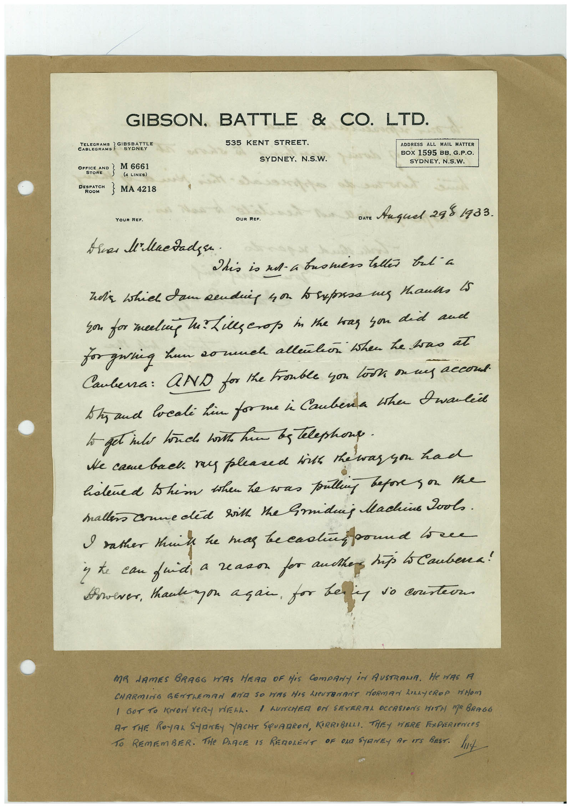

# Book 1 · scan 044

[Original scan](../../images/book-1/large/JPEG/BOOK1%20-%20045.jpg)

## Description

## Transcription

## Context

## Review notes

Compare the machine draft with the scan. Handwriting and names need human review.

## Artifacts

<!-- ARTIFACTS:START -->
Edit the artifacts field in this note’s frontmatter to change these records. This summary is generated.

### B01-S044-A01 — Letter & Handwritten note — Book 1, scan 044

Types: Typed document, Letter, Handwritten note

Scope: Whole scanned page; individual items can be split out during review.

Caption: Not mapped yet.

Caption source: Not recorded yet.

Caption status: unmapped
<!-- ARTIFACTS:END -->

## Machine transcription

<!-- OCR:START -->
GIBSON, BATTLE & CO. LTD.
535 KENT STREET.
SYDNEY, N.S.W.
ADDRESS ALL MAIL MATTER
BOX 1595 BB. G.P.O.
SYDNEY. N.S.W.
TELEGRAMS
STONET
OFFEND 2
M 6661
STORE
(4 LINES)
DEPOT } MA 4218
ROOM
YOUR REF.
Dare Anguel 288 1933.
This is ad-a bromess tallis trt a
son for meeling he? Lies crop in the has you did and
for giving hun so much allenkon then he toas at
Cauberra: AND for the trouble you look on my accond.
Shaud locali kin for me i Cauberda the Dwalie
to get into touch both him bs telephone.
He came back. ra pleased hits the was you had
hatered thim then he was pulling befores or the
mallers Conneded sikh the Smiding Machine Pools.
I rather theike he mas be cadinbound to ene
y te can frid, a reason for authen, hip lo Caubena!
However, tankagon açan, for bery so costers
MA NAMES BRAGG WAS HERO OF HiS COmPANY iN AUSTRAMA.
He was A
CHARMING GENTLEMAN AND SO HAS HIS LICUTEMANT HORMAN LILAYCROP MHOM
I GOT TO KHON VERY WELL. I LUNCHER ON SEVERITA OCCASIONS WITH MA BRAGG
AT THE ROYAL SYDNEY YACHT SQUADRON, KIRRIBALI, THEY WERE EXPERIENCeS
TO REMEMBER. THe PARCE IS REDOLENT OF OND SYRNEy AT ATS BEST.
hut
<!-- OCR:END -->
