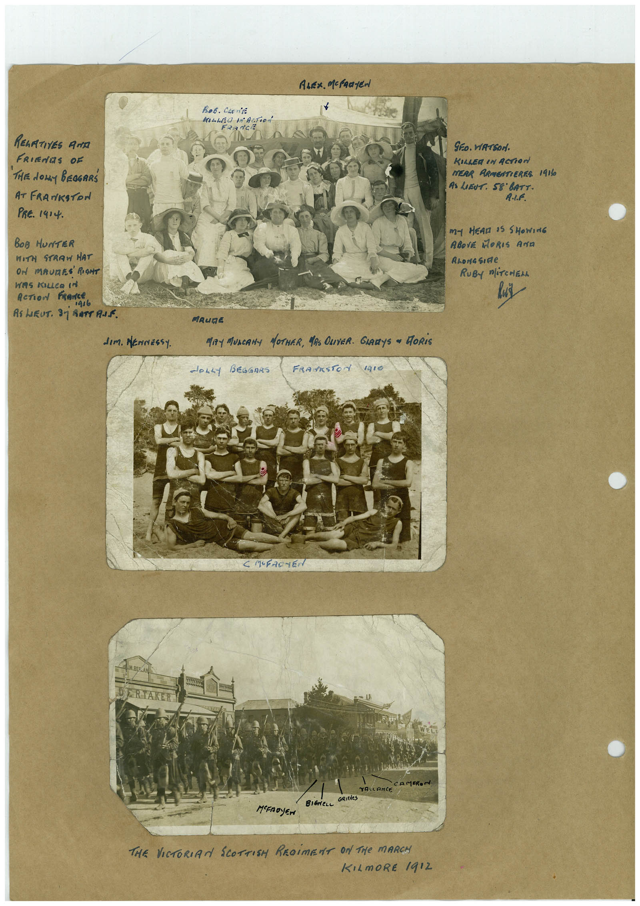

# Book 1 · scan 045

[Original scan](../../images/book-1/large/JPEG/BOOK1%20-%20046.jpg)

## Description

## Transcription

## Context

## Review notes

Compare the machine draft with the scan. Handwriting and names need human review.

## Artifacts

<!-- ARTIFACTS:START -->
Edit the artifacts field in this note’s frontmatter to change these records. This summary is generated.

### B01-S045-A01 — Photo & Handwritten note — Book 1, scan 045

Types: Photo, Handwritten note

Scope: Whole scanned page; individual items can be split out during review.

Caption: Not mapped yet.

Caption source: Not recorded yet.

Caption status: unmapped
<!-- ARTIFACTS:END -->

## Machine transcription

<!-- OCR:START -->
ALex. Mcfaayen
Вов. Сконів
lLEd MAcTioN
FR-ACE
RELATIVES ANA
FRIEdES OF
THEE dowy BEOGRRŚ
AT FRANKSTON
PRE. 1414.
BOB HUNTER
WITH STRAW HAT
ON MAURES RONT
WAS KILLeR In
AcTioN FRANCe
1дs6
RS LaRUT. Sj BATT ANE
GEo. WATSON.
KILLER IN ACTION
MERR ARMEATIEREE 1916
AS LIBUT: S8 BATT.
R.L.F.
M- HEAL 35 SHOWING
ABOVE MORIS ANTA
ALona Sirte
RUBY MiTCHEN
dIm. MENNESSY.
MAUDE
MAY MUSCANA MOTHER, MR ONVER. GIARYS ~ MORiS
doLLy BEGOARS
FRASESTON gIO
C M-FAC-EN
→ CAMERON
YALLRNCE
GRIELeS
BiéMeLc
MEEROYEN
THE VICTORIAN SCOTTISH REGiMENT ON THe MARCH
KILmORE 1912
<!-- OCR:END -->
