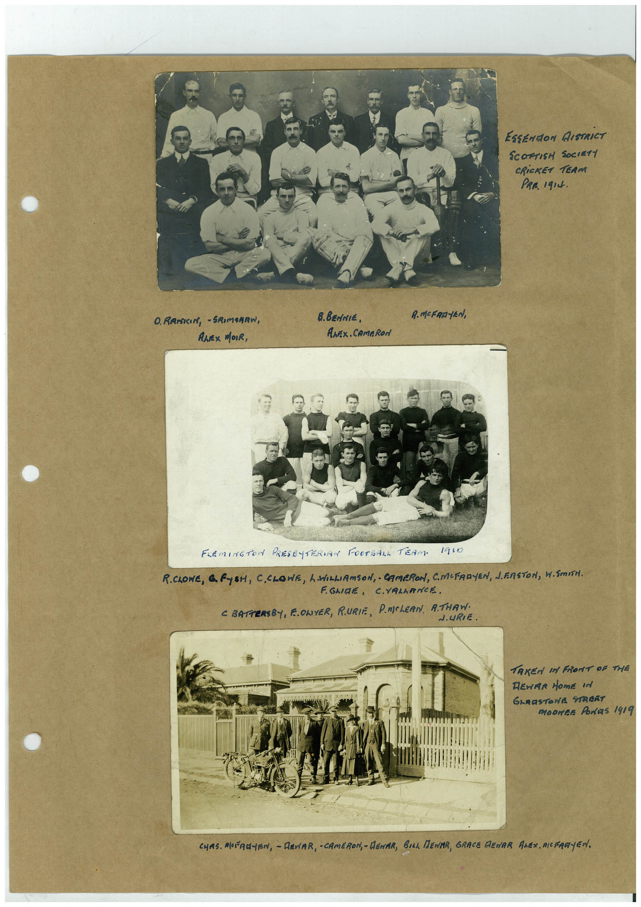

# Book 1 · scan 046

[Original scan](../../images/book-1/large/JPEG/BOOK1%20-%20047.jpg)

## Description

## Transcription

## Context

## Review notes

Compare the machine draft with the scan. Handwriting and names need human review.

## Artifacts

<!-- ARTIFACTS:START -->
Edit the artifacts field in this note’s frontmatter to change these records. This summary is generated.

### B01-S046-A01 — Photo & Handwritten note — Book 1, scan 046

Types: Photo, Handwritten note

Scope: Whole scanned page; individual items can be split out during review.

Caption: Not mapped yet.

Caption source: Not recorded yet.

Caption status: unmapped
<!-- ARTIFACTS:END -->

## Machine transcription

<!-- OCR:START -->
ESSENION AISTRICT
SCOFTISH SOCIETY
CRICKET TEAM
PRR. 1914.
O. RANICIN, - SRIMARRW,
ALEX MOIR,
в. ВЕннІє,
AnEx. CAmeRon
A. MCFRR-(EN),
FLEMINGTO PRESE TERIAN FOOTBALL TEAM. 1910
R.OWE, GRYSH, C.CLOWE, L WILLIAMSON, CAMERON, C.MEFRRYEN, J.ERSTON, W.SmITH.
EGLIRE, C.VRLARNCE.
C BATTERSEY, ELOWYER, RURIR, DmCLERN, ATHAN.
J.URIE.
TAKEN IN FRONT OF THE
TEMAR MOME IN
GERASTONE STReRT
MOONRE PONRS 1419
CHAS. MEFRA-EN, - REVAR, - CAMERON, - AGNAR, BILL MENAR, GRACE MENAR ANEN, MICFRGYEN.
<!-- OCR:END -->
