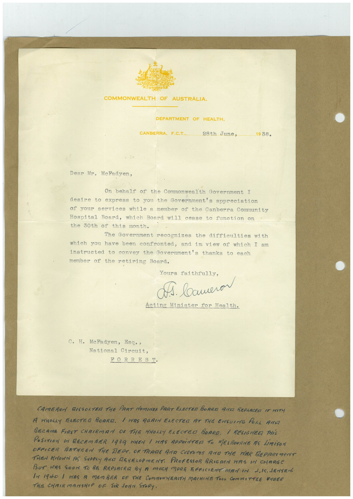

# Book 1 · scan 047

[Original scan](../../images/book-1/large/JPEG/BOOK1%20-%20048.jpg)

## Description

## Transcription

## Context

## Review notes

Compare the machine draft with the scan. Handwriting and names need human review.

## Artifacts

<!-- ARTIFACTS:START -->
Edit the artifacts field in this note’s frontmatter to change these records. This summary is generated.

### B01-S047-A01 — Letter & Handwritten note — Book 1, scan 047

Types: Typed document, Letter, Handwritten note

Scope: Whole scanned page; individual items can be split out during review.

Caption: Not mapped yet.

Caption source: Not recorded yet.

Caption status: unmapped
<!-- ARTIFACTS:END -->

## Machine transcription

<!-- OCR:START -->
COMMONWEALTH OF AUSTRALIA.
DEPARTMENT OF HEALTH.
CANBERRA, F.C.T.,
28th June,
1938.
Dear Mr. MeFadyen,
On behalf of the Commonwealth Government I
desire to express to you the Government's appreciation
of your services while a member of the Canberra Community
Hospital Board, which Board will cease to function on
the 30th of this month.
The Government recognizes the difficulties with
which you have been confronted, and in view of which I am
instructed to convey the Government's thanks to each
member of the retiring Board.
Yours faithfully,
Д. вашегом
Acting Minister for Health.
C. H. McFadyen, Esq.,
National Circuit,
FORREST.
CAMERON DISSOLTER THE PART NOMINEE PART ELECTEL BORRA AM REPLACER IT WITH
A WHOLLY FAECTED BOARA. I WAS AGAIN ELECTRA AT THE ENGUING POLL AMM
BECAME FIRST CHRIRMAN OF THE NHOLLY ELECTED BOARD. / RESIGNED THiS
POSITION SM RECEMBER 1939 WHEN 1 WAS APPOiNTER TO MELBOURNE AS LIMiSON
OFFICER BETHEEN THE DERA. OF TRADE AND CUSTOMS RIO THE HAR MEPARIMENT
THEN KNOWN AS SUPPLY AND REVELOPMENT. PROFESSOR BRIGREN WAS IN CHARGE
BUT NAS SOON TO BE REPLACEL BY A MUCH MORE EFFICIENT MAN IN J,K. JENSEN
IN 19hO / WAS A MEMBER DF THE COMMONNEALTM MACHINE TOOL COmmITTEE UNDER
THIE CHAIRMANSHIP OF SIR JONN STORY.
<!-- OCR:END -->
