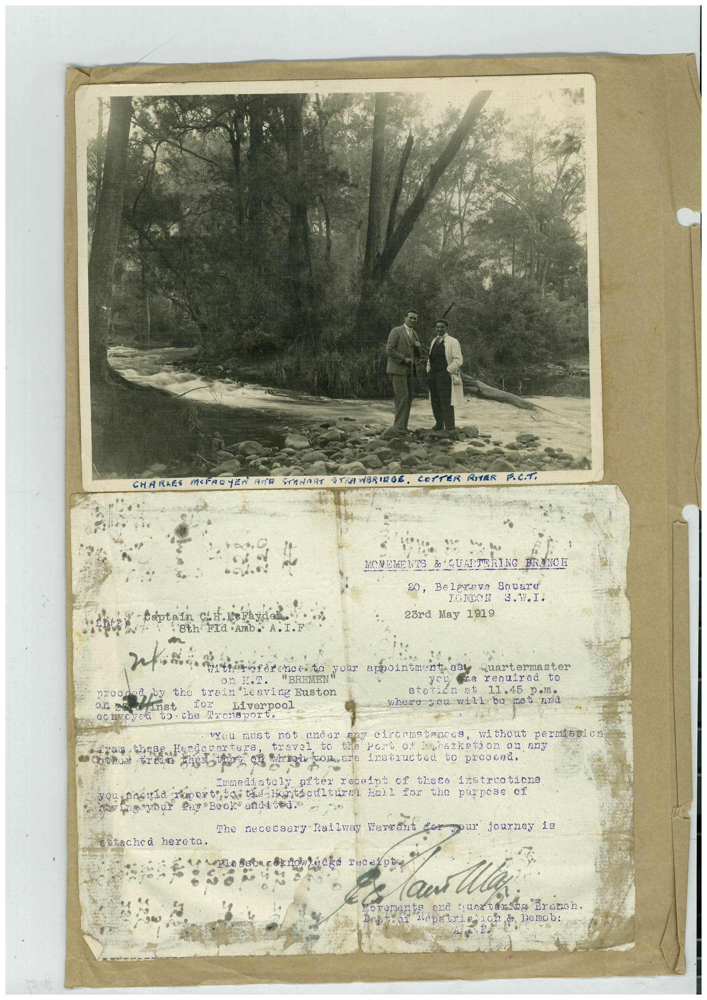

# Book 1 · scan 049

[Original scan](../../images/book-1/large/JPEG/BOOK1%20-%20050.jpg)

## Description

## Transcription

## Context

## Review notes

Compare the machine draft with the scan. Handwriting and names need human review.

## Artifacts

<!-- ARTIFACTS:START -->
Edit the artifacts field in this note’s frontmatter to change these records. This summary is generated.

### B01-S049-A01 — Photo, Letter & Handwritten note — Book 1, scan 049

Types: Photo, Letter, Handwritten note

Scope: Whole scanned page; individual items can be split out during review.

Caption: Not mapped yet.

Caption source: Not recorded yet.

Caption status: unmapped
<!-- ARTIFACTS:END -->

## Machine transcription

<!-- OCR:START -->
CHA RAES
MOPACTER AMA STENART STRAWBRIRGE.
cor
ER
RHER P.C.T.
NOVEMENTS & QUATERING BRANCH
20, Belerove Snuare
TONDON
8.W.I.
23rd May 1919
8th Fla Amb. A.I.F
proctoy the train leaving Euston
caveyda the Drensport
Liver pool
are renuired to
statin et 11.45
where you will be met and
You must not under apy circumstances,
without permission
frog these Hondarerters,
travel to the Poru of pharkemon on any
othon trein then that on higi you ene instructed to proceed.
Immediatoly after receipt of theca instruotions
on t to than Hat ture sat tor too purpose
having your Pay Beok endied.
The necesary Railway Warrant for gour journey is
stached hereto.
Dest. 01
ond tunetoring Branch.
<!-- OCR:END -->
