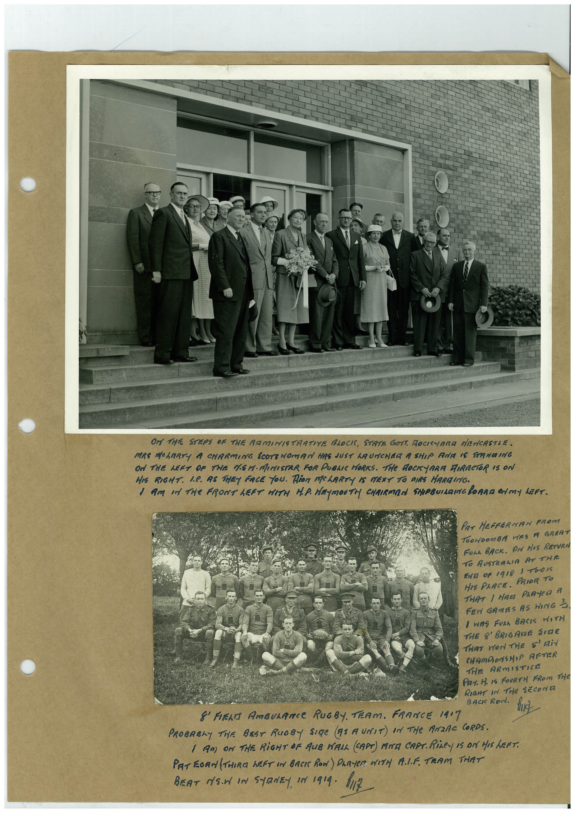

# Book 1 · scan 050

[Original scan](../../images/book-1/large/JPEG/BOOK1%20-%20051.jpg)

## Description

## Transcription

## Context

## Review notes

Compare the machine draft with the scan. Handwriting and names need human review.

## Artifacts

<!-- ARTIFACTS:START -->
Edit the artifacts field in this note’s frontmatter to change these records. This summary is generated.

### B01-S050-A01 — Photo & Handwritten note — Book 1, scan 050

Types: Photo, Handwritten note

Scope: Whole scanned page; individual items can be split out during review.

Caption: Not mapped yet.

Caption source: Not recorded yet.

Caption status: unmapped
<!-- ARTIFACTS:END -->

## Machine transcription

<!-- OCR:START -->
Or THE STEPS OF THE ARMINISTRATIVE BLOCK, STRTE GOYT, ROCKYARa NEWCASTLE.
MRS MOLARTY A CHARMING SCOTEHOMAN HAS JUST ARUNCHER A SHIP ROE IS STRATING
ON THE LEFT OF THE NSM. MINISTAR FOR PUBLIC HORKS. THe ROCKYARA DIRECTOR IS ON
HIS RIGHT. L.C. AS THEY FACE YOU. RiOR MCLARTY IS MEXT TO DIRS HARDING.
I AM IN THe FRONT LET WITH H.P. HEMOUTH CHAIRMAN SHIPBUILDING BORAM ON MY LEFT.
PAT HEFFERNAN FROM
TOONOOnBA HAS A GRERT
FULL BACK. AM HIS RETURN
TO AUSTRALIA AT THE
END OF 1918 1 TOIS
HIS PRACE. PRIOR TO
THAT / HAEI PRAYeR A
FEr GAmES AS HING 3
/ WAS FURA BASIS MOTH
THE 8' BRIGARE SURE
THAT WON THE SAIN
CHAMDONSHIP AFTER
THE ARMISTICE
Par. H. Is FOURTH FRom THe
RIGHT IN THE SECOND
8' FIERA AMBULANCe RUGBY. TEAM. FRANCE 1417
BACK RoN.
fric
PROBABLY THE BRET RUGBY SIRe (AS A UNIT) IN THe ANZAC CORPS.
( AM) OM THE RiGHT OF AUB VALL (CAPT) ANA CAPT. RiLeY 15 ON HIS LEFT.
PAT EGAN (THIRE hEFT IN BACK RON) PLAYER WITH ALF. TRAM THAT
BEAT NS.N IN STRNEY IN 1919. 1117
<!-- OCR:END -->
