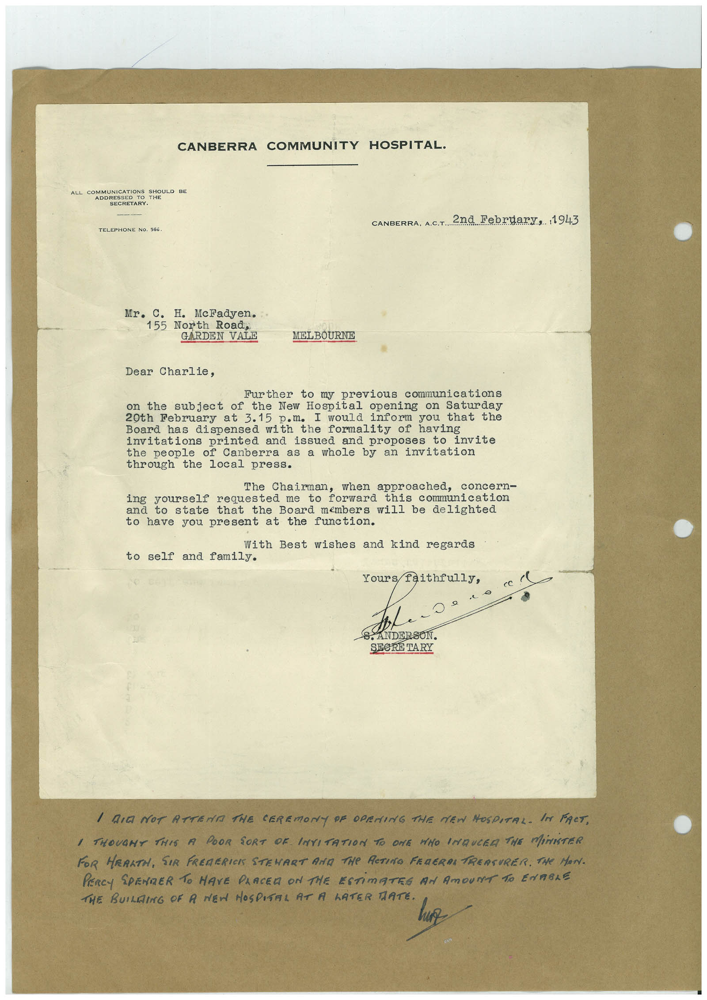

# Book 1 · scan 051

[Original scan](../../images/book-1/large/JPEG/BOOK1%20-%20052.jpg)

## Description

## Transcription

## Context

## Review notes

Compare the machine draft with the scan. Handwriting and names need human review.

## Artifacts

<!-- ARTIFACTS:START -->
Edit the artifacts field in this note’s frontmatter to change these records. This summary is generated.

### B01-S051-A01 — Letter — Book 1, scan 051

Types: Typed document, Letter

Scope: Whole scanned page; individual items can be split out during review.

Caption: Not mapped yet.

Caption source: Not recorded yet.

Caption status: unmapped
<!-- ARTIFACTS:END -->

## Machine transcription

<!-- OCR:START -->
CANBERRA COMMUNITY HOSPITAL•
ALL COMMUNICATIONS SHOULD BE
ADDRESSED
SECRETARY.
TELEPHONE NO. 566.
CANBERRA, A.C.T. 2nd February, 1943
Mr.
C.
H. McFadyen.
155 North Road,
GARDEN VALE
MELBOURNE
Dear Charlie,
Further to my previous communications
subject of the New Hospital
opening on Saturday
20th February at 3.15 p.m. I would inform you that the
Board has dispensed with
the formality of having
invitations printed and
proposes to invite
the people of Canberra as a whole by an invitation
through the local press.
The Chairman, when approached, concern-
ing yourself requested me
forward this communication
state that the Board members will be delighted
to have you present at the function.
With Best wishes and kind regards
to self and family.
Yours faithfully,
c -
SEBRE TARY
I DID NOT ATTENA THE CEREMONY PE OPENING THE MEN HOSPITAL. IM FACT.
I THOUGHT THIS A POOR SORT OR INVITATION TO ONE MHO INDUCEA THE MiNISTER
FOR HEARTH, SIR FREDERICS STEMART AMA THe RETINO FRAGRAs TREASURER. THe MAN.
PERCY SPENDER TO HAVE PLACER ON THE ESTiMATEE AN AmOUNT TO ENTERE
THE BUILDING OF A NEW HOSPITAL AT A LATER TATE.
<!-- OCR:END -->
