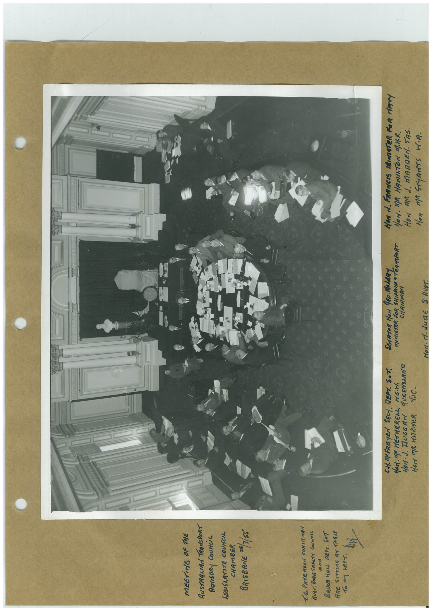

# Book 1 · scan 052

[Original scan](../../images/book-1/large/JPEG/BOOK1%20-%20053.jpg)

## Description

## Transcription

## Context

## Review notes

Compare the machine draft with the scan. Handwriting and names need human review.

## Artifacts

<!-- ARTIFACTS:START -->
Edit the artifacts field in this note’s frontmatter to change these records. This summary is generated.

### B01-S052-A01 — Photo & Handwritten note — Book 1, scan 052

Types: Photo, Handwritten note

Scope: Whole scanned page; individual items can be split out during review.

Caption: Not mapped yet.

Caption source: Not recorded yet.

Caption status: unmapped
<!-- ARTIFACTS:END -->

## Machine transcription

<!-- OCR:START -->
MEETiNG OF THE
AUSTAALIAA TRANSPORT
RarISORy COUNCiL
LEGISLATIVE COUNCIL
CHAMBER
BRISBANE *5/1/55
1. G. PATERSon CHRIRMAN
AusT. RORA SAFETY COUNCIL
BRUCE HALL REPT. SAT
ARE SITTING AT TABLE
To mY LEFT.
CH.MEFAR YEN SECT. REPT. SOT.
HOM. MR WETHERELL
QUEENSLANE
HOr MR. WARNER.
VIc.
SENATOR MON CEO Me LADY
MINISTER FOR SHIPPINE TRANSPORA
CHAIRMAN
or
• June
I AUST.
HON d. FRANCIS MINISTER FOR MANY
HON. MR HAMIATON M.H.R.
HON MR N. MADDEN. TAS.
HON MR STyANTS W.A.
<!-- OCR:END -->
