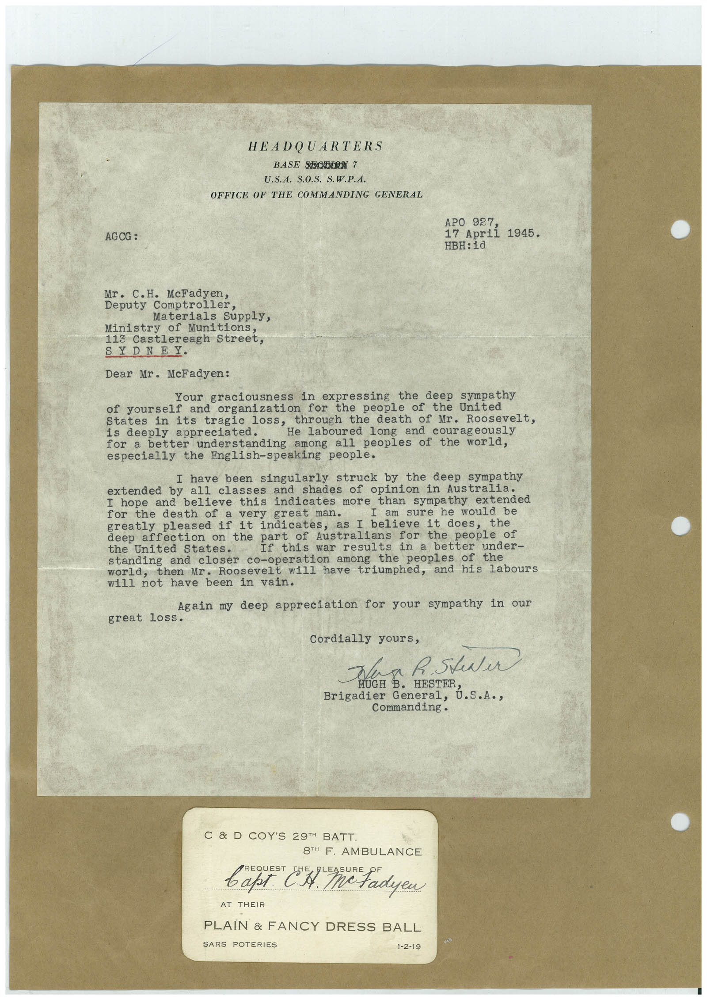

# Book 1 · scan 053

[Original scan](../../images/book-1/large/JPEG/BOOK1%20-%20054.jpg)

## Description

## Transcription

## Context

## Review notes

Compare the machine draft with the scan. Handwriting and names need human review.

## Artifacts

<!-- ARTIFACTS:START -->
Edit the artifacts field in this note’s frontmatter to change these records. This summary is generated.

### B01-S053-A01 — Letter & Handwritten note — Book 1, scan 053

Types: Typed document, Letter, Handwritten note

Scope: Whole scanned page; individual items can be split out during review.

Caption: Not mapped yet.

Caption source: Not recorded yet.

Caption status: unmapped
<!-- ARTIFACTS:END -->

## Machine transcription

<!-- OCR:START -->
HEADQUARTERS
BASE SHOELON Y
U.S.A. S.O.S. S.W.P.A.
OFFICE OF THE COMMANDING GENERAL
AGCG :
APO 927,
17 April
1945.
HBH: id
Mr. C.H. McFadyen,
Deputy Comptroller,
Materials Supply,
Ministry of Munitions,
113 Castlereagh Street,
SYDNEY.
Dear Mr. McFadyen:
Your graciousness in expressing the deep sympathy
of yourself and organization for the people of the United
through the death of Mr. Roosevelt,
States in its tragie los He Laboured long and courageously
is deeply appreciated.
for a better understanding among all peoples of the world,
especially the English-speaking people.
I have been singularly struck by the deep sympathy
extended by all classes and shades of opinion in Australia.
I hope and believe this indicates more than sympathy extended
for the death of a very great man.
I am sure he would be
greatly pleased if it indicates, as I believe it does,
deep affection on the part of Australians for the people of
the United States.
If this war results in a better under-
standing and closer co-operation among the peoples of the
then Mr. Roosevelt will have triumphed, and his labours
will not have been in vain.
Again my deep appreciation for your sympathy in our
great loss.
Cordially yours,
Tea h. Steer
HUGH
Brigadier
Commanding.
C & D COY'S 29™H BATT
8TH F. AMBULANCE
REQUEST
варт. С.А.
AT THEIR
PLAIN & FANCY DRESS BALL
SARS POTERIES
1-2-19
<!-- OCR:END -->
