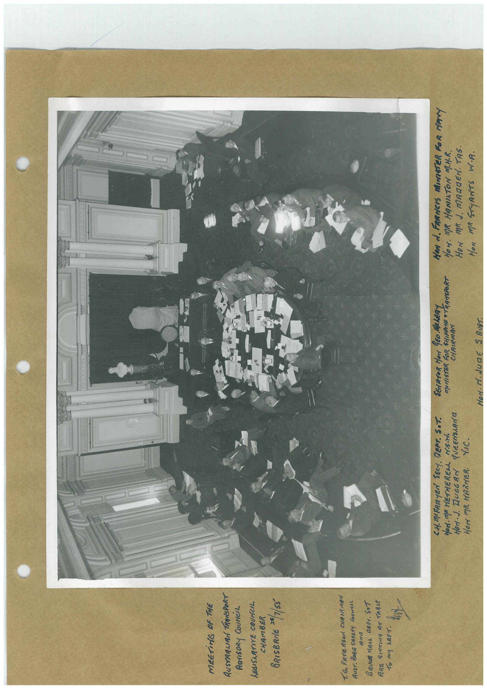

# Book 1 · scan 054

[Original scan](../../images/book-1/large/JPEG/BOOK1%20-%20055.jpg)

## Description

## Transcription

## Context

## Review notes

Compare the machine draft with the scan. Handwriting and names need human review.

## Artifacts

<!-- ARTIFACTS:START -->
Edit the artifacts field in this note’s frontmatter to change these records. This summary is generated.

### B01-S054-A01 — Photo & Handwritten note — Book 1, scan 054

Types: Photo, Handwritten note

Scope: Whole scanned page; individual items can be split out during review.

Caption: Not mapped yet.

Caption source: Not recorded yet.

Caption status: unmapped
<!-- ARTIFACTS:END -->

## Machine transcription

<!-- OCR:START -->
MEETING OF THE
RUSTRALIRA TRANSPORT
AGrISORy COUNCiL
LEGISRATITE COUNCIL
CHAMBER
BRISBANE **/1/55
1. G. PRTE RSON CHRIR MRN
Aust, RoRa SAFETY CoUrCEL
Arra
BRUCR HRLL REPT. SAT
ARE SITTING AT TABLE
T6 MY LEFT.
C.H.MEFARYEN SECY. REPT. S.T.
HON. MR HETHEREnL MS.H
HOrI• J. JUGGAN QUEENSLANO
HOrt MR. HARNER.
V.IC.
SENATOR HON GEO. MeLERY
TUNISTER FOR SHIPPING TRANSPORT
CHAIRMAN
M. JunE
S AUST.
HON A. FRANCIS MUNISTER FOR MArY
HOM. MR HAMILTON MT.H.R.
HoN mR d. magnEN. TAs.
HON MR STYANTS W.A.
<!-- OCR:END -->
