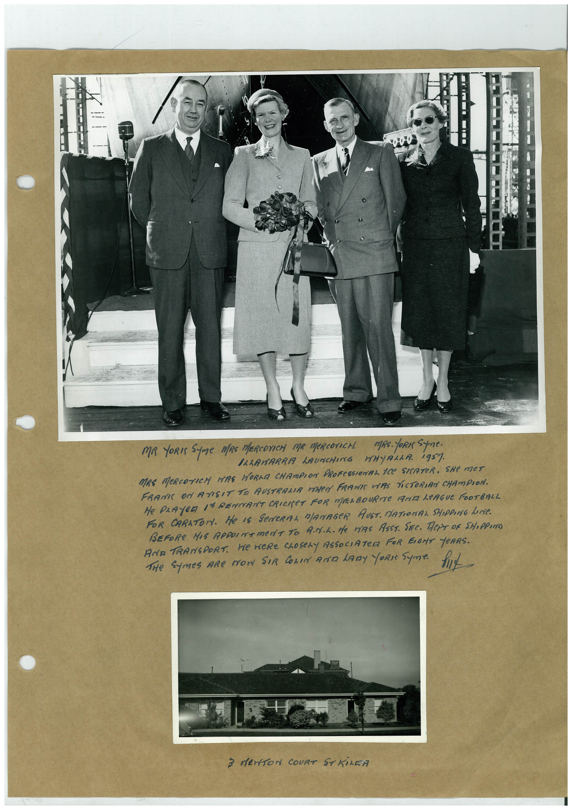

# Book 1 · scan 056

[Original scan](../../images/book-1/large/JPEG/BOOK1%20-%20057.jpg)

## Description

## Transcription

## Context

## Review notes

Compare the machine draft with the scan. Handwriting and names need human review.

## Artifacts

<!-- ARTIFACTS:START -->
Edit the artifacts field in this note’s frontmatter to change these records. This summary is generated.

### B01-S056-A01 — Photo & Handwritten note — Book 1, scan 056

Types: Photo, Handwritten note

Scope: Whole scanned page; individual items can be split out during review.

Caption: Not mapped yet.

Caption source: Not recorded yet.

Caption status: unmapped
<!-- ARTIFACTS:END -->

## Machine transcription

<!-- OCR:START -->
MR YORI SUme MRS MERCOXICH MR MeRCOTICH. MRs. YORN Spne.
ILLAWARRA LAUNCHING WHYALLA. 1957
MRE MeRCOTICH HERE HORMA CHAMPION PROFESSIOMAL ICE SITATER. SHe MET
FRAME ON ATISIT TO AUSTRALIA VEHRA FRANIE VAS PICTORIAN CHAMPION.
He PLAYER IN RENANT CRICET FOR MELBOURNe ANT LeAGUe FOOTBALL
FOR CARATON. He IS GeNERAL MANAGeR AUST. MATIONAL SHIPPING LeNie.
BEFORE HIS REPOINTMeNT TO ANIL. He MYRS ASST. SEE. TePT OF SHOPPING
AND TRANSPORT. We WeRE CLOSeLY ASSOCIATeR FOR EIGHT YeARS.
THe Symes ARe MOW SIR COLIN AND LADy ORI SUme.
3 MENTON COURT ST KILEA
<!-- OCR:END -->
