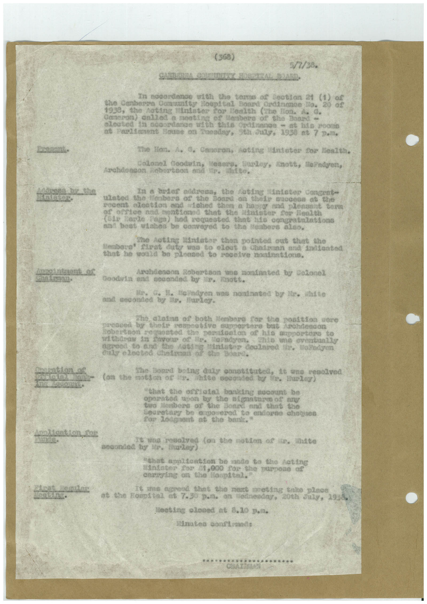

# Book 1 · scan 057

[Original scan](../../images/book-1/large/JPEG/BOOK1%20-%20058.jpg)

## Description

## Transcription

## Context

## Review notes

Compare the machine draft with the scan. Handwriting and names need human review.

## Artifacts

<!-- ARTIFACTS:START -->
Edit the artifacts field in this note’s frontmatter to change these records. This summary is generated.

### B01-S057-A01 — Typed document — Book 1, scan 057

Types: Typed document

Scope: Whole scanned page; individual items can be split out during review.

Caption: Not mapped yet.

Caption source: Not recorded yet.

Caption status: unmapped
<!-- ARTIFACTS:END -->

## Machine transcription

<!-- OCR:START -->
(368)
5/1/38.
In nocordance with the toma of Cootion 21 (1)
the Canberra Community Hoopital Board Ordinance To.
20
1938, the noting finlater for lenith (The Ion. A G.
Ganeron) aniled a moating of lenbers of
the Board -
alcated i1 goosedango with thie Ordinnes - at bis soone
at Feelinent House on Zueeday,
Sth аиду, 1930 et 7 р.л.
The
Hon.
" Canopony
-Acting
(Enseter for Mealth,
Colonel Goodwin,
Losers,
Sunder,
Archdondon Robertson esdr.
anots, HePndyen,
catte.
In a briet address, the Coting intater concent-
ulated the flenberg of the hosza on their auogesa of the
pocent alestion and lobed then a happy and plepunnt on
bertee and heationed that the ladster for Health
Carte
Rega) had requested that nto congratiniations
and beat wishes be cosvered to the seabors aleo,
Mintater thon pointed out that the
Herbore!
duty won to eloct & Chatmann and Indented
that he would
pleased so roceive noninstiond.
Archdeaoon Robertson une montanted by Colonel
Goodila and
seconded by lin, tott.
readyen was nontnated by
white
and seconded
Hurley.
Sobertion
Only elected
the noalsion upre
ative supportera bat Anchdesson
operatoston of his
supportors to
Порадуел.
who eventually
Mindster Coolated
1. Nobodyen
bone daly ennesitated,
ma65
hite seconded by
1, Hurley
"Chat
the ore atal banking soomant be
operated upon by the signature of any
two Members or the Board and that the
Secretary De @gonered to endors chogues
For lodgaent
at the bant."
-wes resolved ton the notion of in, inite
seconded by in unles
"that apoltention be made to the Acting
Mandater 2o2 01,000 Top. the purpose of
changing on the
lospital,"
Te sne agrend tant the neit cooting tate place
the Hospital
08 7.30 D.л.
on wednesday, 20th July, 19.
Meeting olosed at 8.10 p.л.
Minateo coultened:
<!-- OCR:END -->
