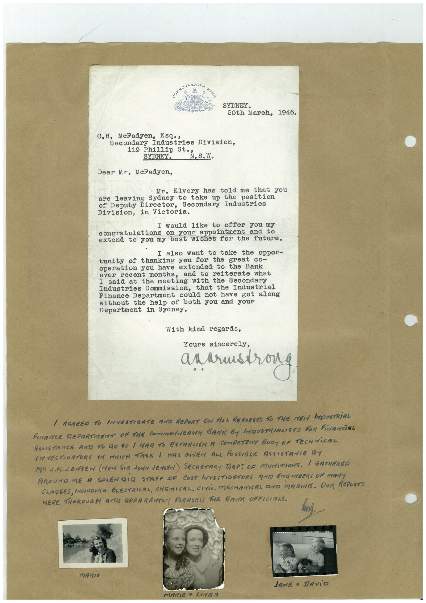

# Book 1 · scan 059

[Original scan](../../images/book-1/large/JPEG/BOOK1%20-%20060.jpg)

## Description

## Transcription

## Context

## Review notes

Compare the machine draft with the scan. Handwriting and names need human review.

## Artifacts

<!-- ARTIFACTS:START -->
Edit the artifacts field in this note’s frontmatter to change these records. This summary is generated.

### B01-S059-A01 — Letter, Photo & Handwritten note — Book 1, scan 059

Types: Typed document, Letter, Photo, Handwritten note

Scope: Whole scanned page; individual items can be split out during review.

Caption: Not mapped yet.

Caption source: Not recorded yet.

Caption status: unmapped
<!-- ARTIFACTS:END -->

## Machine transcription

<!-- OCR:START -->
SYDNEY.
20th March, 1946.
C.H. McFadyen, Esq.,
Secondary Industries Division,
119h1114. St. St. 2.S.W.
Dear Mr. McFadyen,
Mr. Elvery has told me that you
are leaving Sydney to take up the position
of Deputy Director, Secondary Industries
Division, in Victoria.
I would like to offer you my
congratulations on your appointment and to
extend to you my best wishes for the future.
I also want to take the oppor-
tunity of thanking you for the great co-
operation you have extended to the Bank
over recent months, and to reiterate what
I said at the meeting with the Secondary
Industries Commission,
that the Industrial
Finance Department could not have got along
without the help of both you and your
Department in Sydney.
With kind regards,
Yours sincerely,
anarmstrong
/ AGREED TO INVESTIGATE AND REPORT ON ALL REQUESTS TO THE MEN IMDUSTRIAL
FINANCE REPARTMENT OF THE COmmONERKTH BANK By INMUSTRIALISTS FOR FiNANCiAL
ASSISTANCE ARE TO GO SO / MAR TO ESTABLISH A COMPETENT BODY OF TECHNiCAL
INTESTIGATORS IN MHICH TASK I WAS GiVEN ALL POSSIBLE ASSISTANCE BY
MA J.K.L.ENSEN (HOW SIR JONN JENSEN) SECRETARY TEP! OF MUNITIONS. / GATHEREO
AROUNO ME A SPLENDIA STAFF OF COST INTESTIORTORS RAG ENGINBERS OF MANY
CLASSES, INCLURING ELECTRICAL, CHEMICAL, CIVIL, MECHANIAI AND MARINE. OUR REPORTS
HERE THOROUGM AND APPARENTAY PLERSEN THE BANK OFFICIANS.
MARiE
JANE • RAViO
MARIE
LINAR
<!-- OCR:END -->
