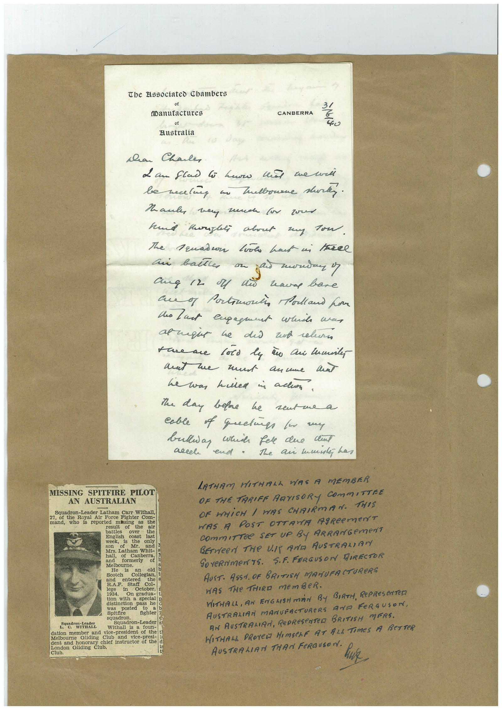

# Book 1 · scan 061

[Original scan](../../images/book-1/large/JPEG/BOOK1%20-%20062.jpg)

## Description

## Transcription

## Context

## Review notes

Compare the machine draft with the scan. Handwriting and names need human review.

## Artifacts

<!-- ARTIFACTS:START -->
Edit the artifacts field in this note’s frontmatter to change these records. This summary is generated.

### B01-S061-A01 — Letter, Newspaper clipping & Handwritten note — Book 1, scan 061

Types: Typed document, Letter, Newspaper clipping, Handwritten note

Scope: Whole scanned page; individual items can be split out during review.

Caption: Not mapped yet.

Caption source: Not recorded yet.

Caption status: unmapped
<!-- ARTIFACTS:END -->

## Machine transcription

<!-- OCR:START -->
Tbe Elssociated Chambers
(Manutactures
of
Australia
CANBERRA
31
40
han Chale
Mane way much (in zoe
hund taglei about my Tow.
The Truadur Look haut ui havel
an ballle on
ang 12 M ni
waves bare
au of Portmontin Polland hor
to last engaget while avan
save me too ly a Cui lumines
mat me mut anume and
he was helled a all.
the day before he sent me a
cable of quetie to my
bulliay which fere due clint
accel
end. The ai manley has
MISSING SPITFIRE PILOT
AN AUSTRALIAN
Squadron-Leader Latham Carr Withall,
27, of the Royal Air Force Fighter Com-
mand,
who is reported
missing
the
the
battles
over
English
the
coast
WONK
last
Mr.
only
and
Sors, Latham Whit
and
formerly
Melbourne.
He
an
old
Scotch
and
Colegian,
entered
the a
lege
Staff
Col-
1934.
tion with a special p
was
pass he
posted
Spitfire
to
fighter
Son stores,
Squadron-Leader
Withall
is
foun-
dation member and vice-president of the t)
Melbourne
Gliding
Club
and vice-presi-
dent and honorary chief instructor of the
London Gliding Club.
LATHAM HITHALA WAS A MEMBER
OR THE TARIFF ARTISORY COMMITTRE
OF WHICH / WAS CHAIRMAN. THIS
HAS A POST OTTAWA AgReeMeNT
CommITTee SET uP By ARRANGemeNT
BErVeeN THe UIT AND AUSTRALIANY
GOVeRNMeNTS. S.F. FERGUSON HIRECTOR
AUST. ASS. OF BRITISH MANUFACTUReRS
WAS THe THIRD memBeR.
WITHALL, AN ENGHSHMAN BY BIRTH, RePReSeNTeD
AUSTRALIAN MANUFACTURERS AND FERGUSON,
AN AUSTRALIRA, PePReSeNTeR BRITISH MERS.
WITHAL PROTeD HIMSeLF AT ALL TIMeS A BeTTeR
AUSTRALIATI THAN FeRGUSON.
<!-- OCR:END -->
