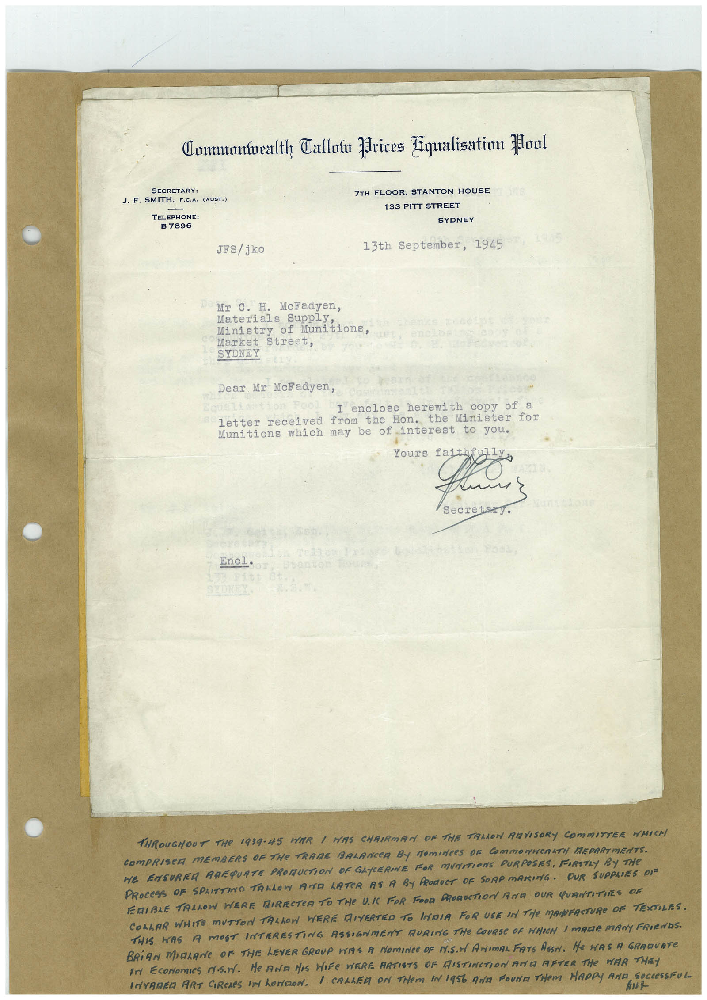

# Book 1 · scan 062

[Original scan](../../images/book-1/large/JPEG/BOOK1%20-%20063.jpg)

## Description

## Transcription

## Context

## Review notes

Compare the machine draft with the scan. Handwriting and names need human review.

## Artifacts

<!-- ARTIFACTS:START -->
Edit the artifacts field in this note’s frontmatter to change these records. This summary is generated.

### B01-S062-A01 — Letter & Handwritten note — Book 1, scan 062

Types: Typed document, Letter, Handwritten note

Scope: Whole scanned page; individual items can be split out during review.

Caption: Not mapped yet.

Caption source: Not recorded yet.

Caption status: unmapped
<!-- ARTIFACTS:END -->

## Machine transcription

<!-- OCR:START -->
Commontealth Callow prices Equalisation Mool
SECRETARY:
J. F. SMITH, F.C.A. (AUST.)
TELEPHONE:
B 7896
JFS/ jko
7TH FLOOR, STANTON HOUSE
133 PITT STREET
SYDNEY
13th September, 1945
Mr C. H. McFadyen,
Materials suppLy.
Ministry of Munitions
Market Street,
SYDNEY
Dear Mr McFadyen,
I enclose herewith copy of a
letter received
from the Hon.
Minister for
Munitions which may be of interest to you.
Yours fa
Secre
Encl•
TNROUGHOUT THe 1939-45 WAR 1 HAS CHRIRMAN OF THE TALLOW RAVISORY COMMITTER WHICH
COMPRISCR MEMBERS OF THe TRADE BALANCeR By NomineeS OF COmmONweRATN EPARTMENTS.
HE ENSUREA AREQUATE PROMUCTION DF GLYCERINE FOR MUNITIONS PURPOSES, FIRSTLY BY THe
PROCESS OF SPLITTINO TALLOW AND LATER AS A BY PRODUCT OF SORP MARING. OUR SUPPLIES DIE
ERIBLE TALLOW HERE MIRECTER TO THE UI FOR FOOD PRORUCTION ArA OUR QURNTITHES OF
COLLAR WHITE MUTTON TALLON WERE DIVERTED TO INDIA FOR USE IN THe MAINFACTURe OF TEXTILES.
THIS HAS A MOST INTERESTING ASSIGNMENT RURING THE COURSE OF WHICH / MARE MANY FRIENDS.
BRiAN MOLANE OF THE LEVER GROUP WAS A NOMINCe OF IY.S.N ANImAL FATS ASSA. He HAS A GRAQUATe
In EcoNomies ds.n. He AND HIS HIFe WERE ARTISTS OF GISTINCTION ArE AFTER THe WAR THEY
INVADER ART CIRCLES IN honoN. I CALLER oN THem IN 1956 ANa FoUNTHem HADPY AND SOCCeSSFU
hunt
<!-- OCR:END -->
